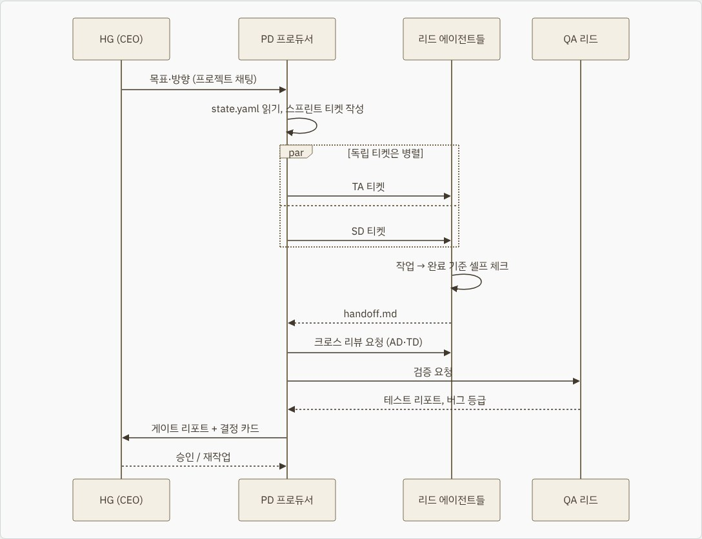
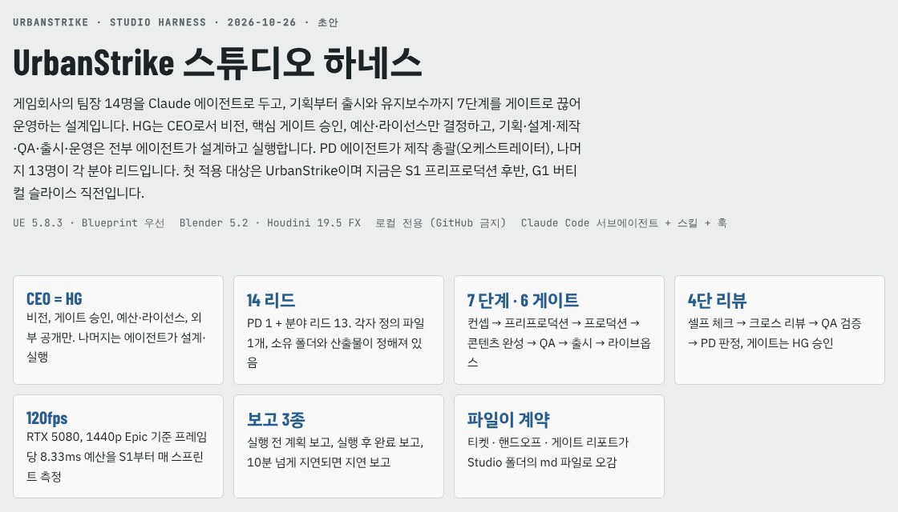

In [the previous post](../2026-10-27-ai-game-studio/) I introduced the first two days of building UrbanStrike with an AI game studio. In this post I'd like to cover **the rules I use to run that studio**, and **the path assets take to get into the game**.

The AI drew up the studio's organization and rules, but I set all the conditions. Deciding who decides what, when to report, and what counts as a failure that means stopping was the thing I spent the most time on in this work.

**Most of this post was written by the AI, and I've reviewed all of it. As I wrote in the previous post, I've never worked at a game company, so some of this may differ from how real game companies work. Please keep that in mind. I think it's most useful as a reference for working with agents.**

## 📐 The result first: the studio harness I built

**The key result of this post is the harness structure that the 14 AI team leads run on.** I (the CEO) give only the goals and direction, the PD splits the work into tickets and assigns them to the leads, and the results go through cross review and QA before coming back to me as an approval request.

**👉 [See the full studio harness design](/NeoDevBlog/en/docs/urbanstrike-studio-harness.html)**: a web doc covering the roles and workflows of the 14 leads, deliverables for each stage, the frame budget, responsibility split (RACI), and the folder, hook and skill structure. I've linked the same doc again in the "14 team lead agents" section below.

## It started with two sentences from me

> "게임회사 팀장 역할을 하는 에이전트를 만들고 하네스로 구성해서 계획·설계해 줘. 기획부터 퍼블리시, 유지보수까지 모두 포함."
> *(Make agents that play game company team leads, organize them as a harness, and plan and design it. Include everything from planning to publishing and maintenance.)*
>
> "나는 게임회사 CEO 역할이고, 나머지 제작 업무는 에이전트들이 설계·실행하는 식으로 만들어."
> *(I'm the game company's CEO, and the agents design and carry out the rest of the production work.)*

From those two sentences, 14 team leads, a seven-stage production process, six gates and reporting rules were created in a single day. I didn't set every rule at the start. I added them one at a time whenever a problem showed up while running it.

### Why I chose this approach

I've done nothing but film VFX for more than 10 years, so I didn't know how a game company runs. Instead, while researching AI I learned about **agent harnesses**, and I was already building and using harnesses for AI tech research and Houdini VFX work. This studio takes the same frame, role-based agents, stage-by-stage approvals and work logs, and fits it to a game company's organization.

Rather than learning an unfamiliar field from scratch before starting, I chose **to let the AI plan the company structure while I hold the decision-making power**. But in practice, making good decisions really did require basic knowledge. So on the next project I plan to also try a simpler engine such as Unity or Godot.

## I keep the decisions and delegate the rest

First I set the things only the CEO decides.

| Only the CEO (me) decides | Why |
| --- | --- |
| Vision and direction, final approval of gates (G0–G5, patches) | I'm responsible for what gets made |
| Public release (store, social media, YouTube) | It goes out under my name |
| Paid purchases, license agreements, account sign-ups and logins | Money and legal responsibility are involved |
| Admin approval prompts (UAC), launcher approvals | Only possible in front of the PC |
| Engine version upgrades, bulk asset deletion | Hard to undo |
| No uploads to GitHub | Large project, keep it private |

Then I boldly handed over the rest.

> "앞으로 중간에 필요한 작업 권한은 너한테 있어. 중간에 결과 보고만 잘해 줘."
> *(From now on, you have the authority for the work needed along the way. Just report the results well.)*

The leads handle in-between work like installing free programs, downloads, settings changes, running scripts and restarting the editor without asking, and report only the results.

## I had them explain words I didn't know

When I got the first report, it was full of abbreviations like sprint, ticket, QA, BR, S1 and G1. So I set a rule.

> "S1 등 약어는 영어 원문도 괄호 안에 함께 표시해. 나는 운영이 처음이라 모르는 단어가 많으니 필요한 기본 단어나 배경지식도 따로 정리해."
> *(Show the original English for abbreviations like S1 in parentheses. I'm new to running this and don't know many words, so also list the basic terms and background knowledge I need.)*

Since then, abbreviations always come with the original term and an explanation, like QA (Quality Assurance, quality testing), and the glossary has grown past 213 entries. We checked stage names like S0–S6 against five sources, including Wikipedia, Unity learning materials, Game Developer and *The Game Production Handbook*. For reference, the S0–S6 numbering isn't an industry standard; it's a label our studio uses. **This is a workflow made by AI, so it may differ from a real game company's system.**

## The 14 team lead agents

| Abbr. | Role | What they do |
| --- | --- | --- |
| PD | Producer | Sprint planning, ticket assignment, reporting to the CEO |
| GD | Game Design | Design doc (GDD), weapon and enemy numbers |
| LD | Level Design | Map blockouts, flow |
| AD | Art Director | Style guide, art reviews |
| A3 | 3D Art | Blender modeling, asset checks |
| TD | Technical Director | Architecture, performance, crash analysis |
| TA | Technical Art | Niagara FX, shaders |
| AN | Animation | Animation, retargeting |
| SD | Sound Design | Sound, MetaSounds |
| UI | User Interface | HUD, menus |
| QA | Quality Assurance | Automated tests, bug reports |
| BR | Build & Release | Package builds |
| PB | Publishing | Videos, store page |
| LO | Live Ops | Patches, maintenance |

The leads communicate only through ticket, handoff and gate report documents in the project's `Studio/` folder. Thanks to that, even if a session drops, the next session can read the status files and pick up right away. I've put the full design, including each lead's workflow and the frame budget, into a web doc.

- [UrbanStrike studio harness design](/NeoDevBlog/en/docs/urbanstrike-studio-harness.html)

## Seven stages and gates, and I do the approving

| Stage | What happens | Gate |
| --- | --- | --- |
| S0 Concept | One-line pitch, references, scope | G0 Greenlight |
| S1 Pre-production | Design doc, pipeline validation, vertical slice | G1 Vertical slice |
| S2 Production | Feature implementation, level blockouts | G2 Alpha |
| S3 Content complete | Final assets, sound and animation | G3 Beta |
| S4 Polish & QA | Package builds, performance and stability | G4 RC |
| S5 Release | Launch, uploads | G5 Release approval |
| S6 Live ops | Patches, maintenance | P# Patch gate |

The leads submit a report for each gate, and I, as CEO, decide whether it passes. UrbanStrike is currently in S1, and the first target is G1 (vertical slice) on November 9.

## I set the reporting rules too

> "중요 단계마다 나에게 보고한 뒤 진행해. 실행 전 계획 보고, 실행 후 보고, 실행 중 10분 이상 지연되면 보고. 작업 단계는 최대한 작게 모듈화해서 관리·문서화해."
> *(Report to me at each important stage before moving on. Report the plan before running, report after running, and report if anything is delayed more than 10 minutes. Keep work steps as small and modular as possible, and manage and document them.)*
>
> "앞으로 작업이 완료되거나, 중간에 승인이 필요하거나, 내 답이 필요하면 바로 보여 줘."
> *(From now on, show me right away when work is done, when an approval is needed, or when you need my answer.)*

| Report | When | Contents |
| --- | --- | --- |
| Plan report | Before running | References researched, goal, work units, estimated time |
| Completion report | After running | Result, pass or fail, measurements, screenshots |
| Delay report | Over 10 minutes | Where it got stuck, next attempt, new estimate |
| Immediate alert | As needed | Right away when an approval or my answer is needed |
| Retry report | Before running again | Which attempt it is, why it's rerunning, what changed |

Work is split into small units (modules) that finish within 30 minutes, and each module leaves a record. I also set the rule "앞으로 작업할 때 새 단계는 관련 레퍼런스 등을 조사한 뒤 진행해" *(from now on, research relevant references before starting a new step)*, so references always come first before a new step.

While running it, I also added rules to cut down on waiting. Options put the recommended one first, and **if I don't answer within 10 minutes, it automatically goes ahead with option 1**. The exceptions, which wait for my answer, are paid purchases, logins, UAC, irreversible deletions, gate approvals and public releases. On the other hand, there were too many notifications, so I cut them back to stage passes and failures, things that need my decision, and completions.

## I decided how testing works too

At first, several features were tested together in one go, so when something failed it was hard to tell where the problem was. So I decided that **every test is split by production step and run in order**.

| Order | Test | Order | Test |
| --- | --- | --- | --- |
| 0 | Project cleanup | 6 | Impact FX by surface |
| 1 | Map, collision, surface materials | 7 | Muzzle flash, casings, tracers, lighting |
| 2 | Player placement, camera | 8 | Niagara pack FX (on hold) |
| 3 | Weapon firing | 9 | Sound |
| 4 | Shooting targets | 10 | HUD |
| 5 | Recoil, animation | 11 | Integration, 120 fps, video |

Each step has a time limit and pass criteria, and only a pass moves on to the next step. Every attempt leaves a video, and if the same failure happens twice, work stops and I get a report. I approved running long tests that tie up the PC, like sound, performance and recording, only at night (01:00–08:00) when I'm not using it. We've passed up to step 4, and step 5, recoil and animation, is fixing the left-hand position and muzzle direction as I asked.

## Splitting roles like a company made things efficient

On the first day, I worked by chatting with a single AI. Planning, art, FX and testing were all mixed into one conversation, and once I asked "what are you working on?" three times over 12 minutes without getting an answer. When I split the agents along the usual roles at a real game company, things ran much more smoothly.

- **Responsibility is clear.** QA finds the bugs, TD looks at causes, and TA fixes the FX. I don't have to decide "who does this?"
- **Work runs in parallel.** Three or four tickets that don't overlap run at the same time. In the first sprint, 12 tickets were finished in a day.
- **Verification has several layers.** Work comes to me only after self-check → cross review by another lead → QA verification → PD's call.
- **Work carries on even if a session drops.** Everything is left as ticket and handoff documents, so the next day a new session just reads the status files and continues.
- **I can follow along without knowing the industry's ways.** The leads stick to how game companies work, with stages, gates and sprints, so I only need to make decisions within that frame.

## Benefits of working with agents

| Benefit | What I actually felt |
| --- | --- |
| The CEO focuses only on decisions | I spent my time on things only a person can do, like changing direction, approvals, and checking sound and picture |
| One rule changes everything | Once I set "stop after 2 crashes," all 14 follow it |
| Records are kept automatically | Every module leaves a log, which became material for this blog post and the YouTube script |
| You can start in an unfamiliar field | I didn't know game production, but I learned as I went through the leads' reports and the glossary |
| Failures are easy to roll back | Work is in 30-minute modules, so a failure only means rolling back that module and redoing it |
| I can give instructions while away | Even when I was out, instructions from my phone kept work going on my home PC |

There are limits, of course. Things only a person can do, like admin approvals, license agreements and listening to sound, still mean waiting. So I changed the rules to collect those and ask all at once.

## 🔥 Walls I hit while running it, and the fixes

### 1. The AI can't edit its own settings

> 🔧 **The fix:** Because of safety rules, the AI can't write to the agent settings folder (`.claude`) directly. So the AI writes the revised version and a script to apply it, and I run a single command.

### 2. Approvals only pass with sentences a person typed

> 🔧 **The fix:** Hard-to-undo things like licenses and downloads didn't pass just by clicking a card. Once I changed it so the AI shows the approval sentence up front ("please write it like this") and I type it in myself, it went through right away. I waited 3 hours 31 minutes because of this.

### 3. Two teams on one editor leads to accidents

> 🔧 **The fix:** Two teams used the editor at the same time and a debris asset file got overwritten. I approved a rule using an `editor.lock` file so only one session writes in the editor at a time, and split the write scope by team. While waiting for the lock, other independent work runs in parallel.

### 4. If the same crash happens twice, we stop

After the FX tool crashed seven times in headless runs, I said "크래시가 반복되면 메모리 버그 확인 등 디버깅 절차를 하네스에 추가해" *(if crashes repeat, add a debugging procedure such as checking for memory bugs to the harness)*. This is the procedure that came out of it.

> 🔧 **Crash response procedure**
> 1. **Stop**: if the same crash happens twice, don't retry; release the lock.
> 2. **Collect**: gather the crash folder, logs, the command that was run, and the last good commit.
> 3. **Classify**: null access, assert, out of memory, GPU, or headless-only.
> 4. **Check memory**: watch the trend with `stat memory` and `memreport -full`.
> 5. **Minimal repro**: split the steps and bisect to narrow down the line that causes it.
> 6. **Separate workaround from real fix**: mark workarounds separately and open a ticket for the real fix.
> 7. **Regression test**: add fixed crashes to the automated tests and check every time that they don't come back.
> 8. **Report to the CEO**: report to me on the second crash, and if three different attempts fail, I decide whether to cut scope or take another approach.

## Asset production pipeline

Once I decided to move from external assets to sources we make ourselves, we built a pipeline around free tools.

| Area | Tool | Path into Unreal |
| --- | --- | --- |
| Modeling | Blender 5.2 (portable) | One-click Send2UE transfer, automatic collision and Nanite setup |
| Textures | Material Maker, Krita | Naming rules (T_, M_, MI_) |
| FX | Built directly in Unreal Niagara | `_v2` systems generated with Python |
| Smoke & dust | Blender Mantaflow | Baked into flipbook textures for Niagara |
| Sound | Audacity, Sonniss free bundle | MetaSounds |

Admin approval prompts (UAC) can't be clicked remotely, so we used the portable version of Blender, which needs no install. Houdini changed direction three times because of version support and licensing, and in the end I settled it.

> "후디니 라이선스 작업은 보류하고, FX 작업은 우선 언리얼 나이아가라 등으로 자체 제작하도록 계획을 바꾼 뒤 진행해."
> *(Put the Houdini license work on hold, change the plan so FX are made in-house with Unreal Niagara and similar tools for now, and continue.)*

Instead of hanging on to blocked work, putting it on hold and taking another route kept the sprint from stalling.

### Example: a shooting range made in Blender

We built a 52 × 32 m range in Blender by script. It went template → 18 kinds of 1 m grid modules → collision → UVs → placement, with captures saved at each step. This is what came out when I had the AI design the range.

These are the 18 modules moved into Unreal with Send2UE. The AI made these assets game-ready automatically.

## Performance target: 120 fps on an RTX 5080

At first there was only one line: "1080p 60fps." I judged that we needed a standard at the level of a real game, and gave this instruction.

> "게임 최적화 과정이 있는지 확인하고, 없으면 RTX 5080 기준 120fps를 목표로 설정해."
> *(Check whether there's a game optimization process, and if not, set a target of 120 fps on an RTX 5080.)*

- Standard: RTX 5080, 1440p Epic quality, 120 fps average (8.33 ms per frame), 1% low of 90 fps or more
- Budget: within 8 ms total GPU time, split into Lumen 2.5 ms, shadows 1.2 ms, FX 0.5 ms and so on
- Measurement: every sprint from S1

The first measurements at the range were 8.66 ms per frame and 4.86 ms on the GPU. The GPU has headroom; right now the game thread (8.61 ms) is the bottleneck and the next optimization target. These were measured inside the editor, so we'll measure again in a packaged build. (Written by the AI.)

## Read it as web docs

I've organized the studio design and its current state into two web docs.

- [UrbanStrike studio harness design](/NeoDevBlog/en/docs/urbanstrike-studio-harness.html): roles and workflows of the 14 leads, deliverables for each stage, the frame budget, responsibility split (RACI), and the harness structure
- [UrbanStrike studio console](/NeoDevBlog/en/docs/urbanstrike-studio-console.html): the current stage and gates, test results for each step, the sprint board, and my decision log (snapshot from 2026-10-27)

## I'll keep updating this together with AI

The studio rules and the pipeline are both still being refined. When new problems show up I'll add rules one at a time, and I'll keep recording that process too. Next time I'll bring the road toward the vertical slice (G1). Thank you for reading.
