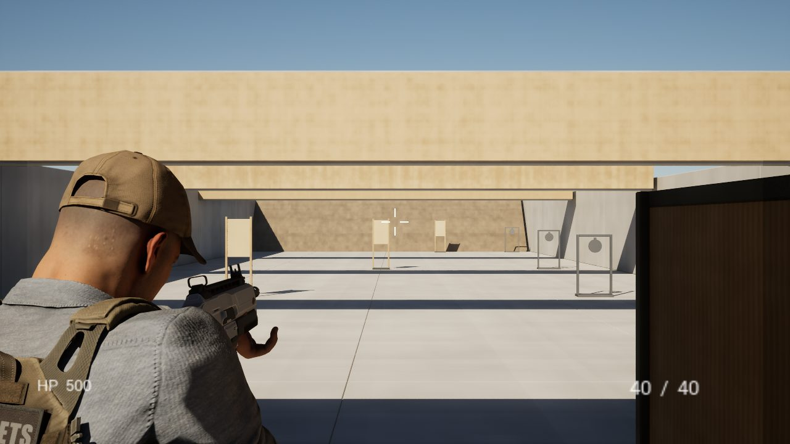
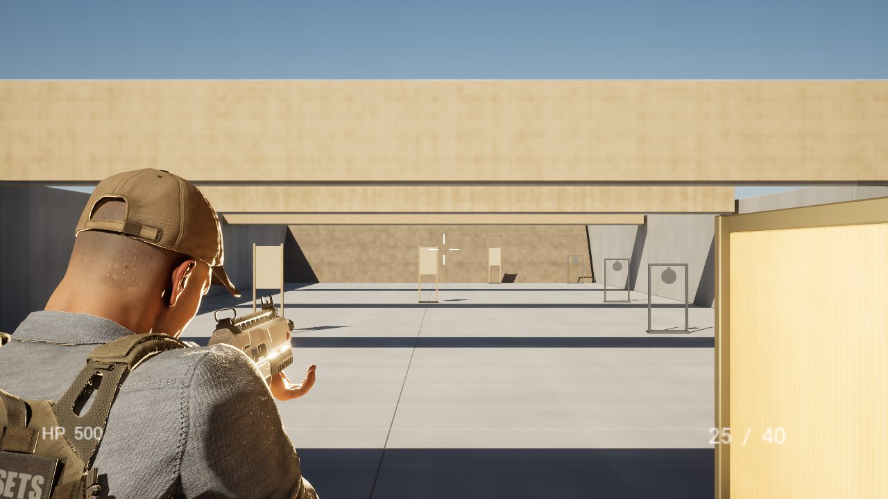
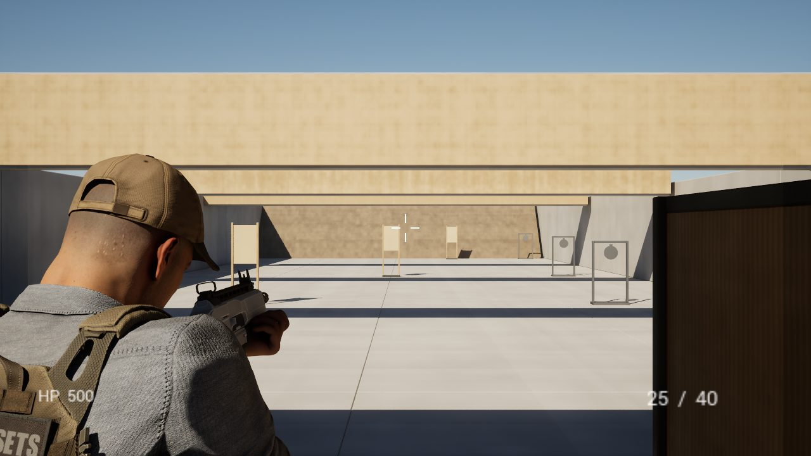
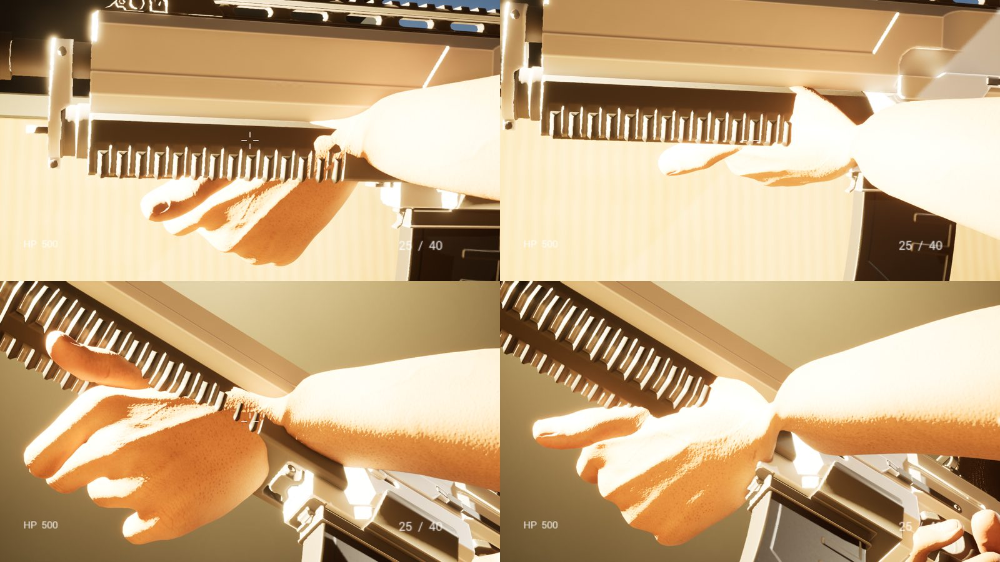
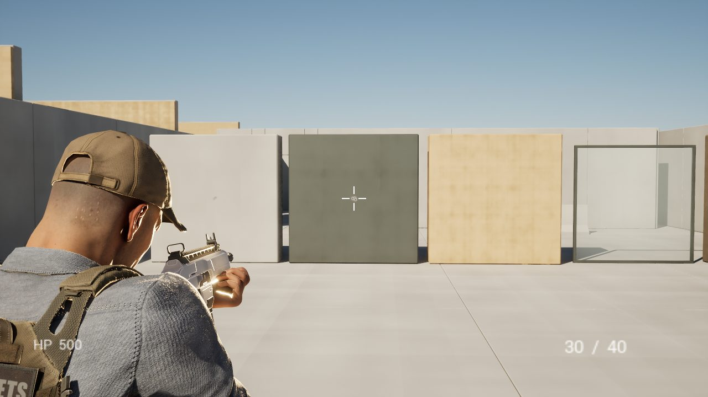
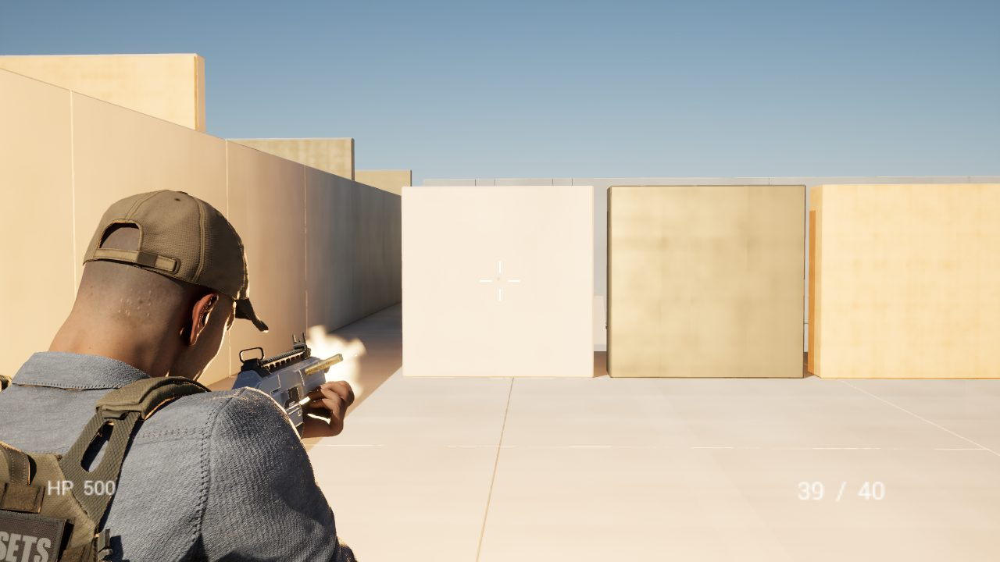
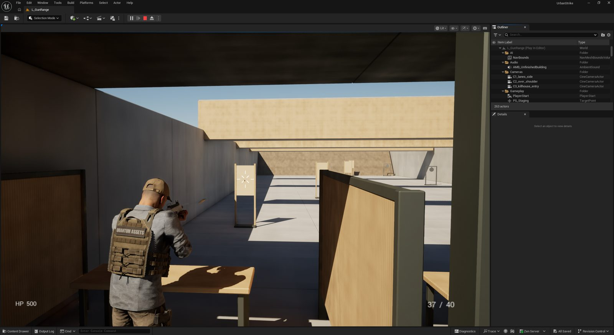

In [the previous post](../2026-10-27-ai-studio-agents-pipeline/) I introduced the rules and pipeline of the studio I built with 14 AI team leads. At that point testing was at "stages up to 4 passed, stage 5 recoil and animation in progress." In this post I'd like to cover the decisions I made while testing **stages 5 through 11**, and the bugs we found along the way.

**This post was also drafted by the AI from the work logs, and I reviewed it. I've never worked at a game company, so this may differ from how real game companies test. Please keep that in mind.**

## At a glance

| Item | Details |
| --- | --- |
| Period | October 27–28 (about 14 hours of actual work) |
| Map | A shooting range built in Blender (L_GunRange) |
| Engine | Unreal Engine 5.8.3 → updated to 5.8.4 during testing |
| Result | Of stages 0–11: 10 passed, 1 on hold (stage 8), 1 open (stage 11, 120fps) |
| Bugs found | Bullets fired from the eyes, an empty impact-effect function, a muzzle light that never turned off, and more |
| Test videos | One per attempt, more than 50 across stages 0–11 |

## I stopped the tests and split them by process

Even after switching to the range map, the target, enemy AI and Niagara FX migration tests were all running at once. The "bullets pass through targets" problem and the "FX migration failed" problem overlapped, and there was no way to tell which was the cause. So I had all the tests stopped.

> "지금 작업중인 테스트들 중지하고 공정 어셋별 작업을 순서대로 언리얼5.8에서 테스트 하는걸로 수정계획 설계하고 알려줘"
> *(Stop the tests in progress, and plan a revised design that tests each process asset in order in Unreal 5.8, then tell me.)*
>
> "앞으로 테스트 작업은 공정별로 나눠서 테스트하게 스킬, 하네스 업데이트해"
> *(From now on, update the skills and harness so tests are split by process.)*

These are the rules I set.

- Each stage covers one asset (process) and one test.
- Each stage has a time limit and a **pass criterion stated as a number**.
- On a pass, only that stage is committed and we move on. On a fail, we don't move to the next stage.
- **If the same failure happens twice, stop and report to me.**
- Every attempt is recorded as a video.

I also set the video names.

> "각 단계별, 프로젝트_진행단계_테스트명_버전_task(시도횟수)로 동영상 저장해"
> *(For each stage, save videos as project_stage_testname_version_task(attempt number).)*

So videos are saved like `urbanstrike_st05_lefthandgrip_v005_t03.mp4`. The name alone tells you the stage, the version and the attempt.

## Since the last post: the real cause found in stages 0–4

In the last post I only wrote "passed up to stage 4," but the biggest discovery happened in between.

> 🔧 **Bullets were coming out of the character's eyes.** Bullets were fired from the **character's eye position**, not from the on-screen crosshair (the over-the-shoulder camera). The camera sits 2.6m behind and 75cm to the right of the character, so it was off from the crosshair by up to 4.6°. That was the real cause of bullets "passing through" targets all along. We moved the firing point to the camera crosshair and confirmed all 50 shots landed within the crosshair's spread angle.

Without splitting by process, this bug would have been mixed up with the target and enemy AI problems and been hard to find.

## Stage 5. I fixed the left-hand grip five times by eye

Stage 5 is recoil, left-hand grip and muzzle direction. The test passed, but on screen the left hand wasn't really holding the gun. From here on I watched it myself and pointed things out one at a time.

> "총기 애니메이션이 왼손 위치에 맞지 않는데, 총열이 손 위로 오고, 정면을 바라보게 수정해"
> *(The gun animation doesn't match the left hand. Put the barrel above the hand and make it face forward.)*
>
> "총구가 살짝 위를 바라보는데, 총구가 정면을 보게 수정해"
> *(The muzzle points slightly up. Make it face straight ahead.)*
>
> "총위치는 맞아보이고 총을 받히는 왼손이 총열 위치와 오프셋되서 맞지 않는데 왼손가락 기준으로 총열에 맞게 손 위치만 애니메이션 수정해, 총위치는 맞어"
> *(The gun position looks right, but the supporting left hand is offset from the barrel. Using the left fingers as the reference, fix only the hand position in the animation to fit the barrel. The gun position is correct.)*
>
> "손가락 끝은 유지하고 손바닥이 총열 아레에 맞고 손이 뭉치지 않게 수정해"
> *(Keep the fingertips, fit the palm under the barrel, and don't let the hand bunch up.)*
>
> "손모양은 유지하고 손목 위치만 수정서 잡고 있는 모양이 안어색하게 수정해봐"
> *(Keep the hand shape and adjust only the wrist so the grip doesn't look awkward.)*

The AI turned my words into numeric criteria: muzzle within 3° of straight ahead, palm under the barrel, and zero depth of fingers sinking into the gun. It also fixed the muzzle, which was pointing 12° above the camera, to within 1.6°. At the end, looking 45° down, the thumb sank in by 0.3–0.5cm and failed twice, and turning the wrist further made the ring finger sink in instead. In the end it passed by **straightening only the thumb by 4°**.

Stage 5 alone produced 22 videos. It was the longest stage.

*🎬 Test video coming soon: stage 5 left-hand grip, v001 → v005*

> 💡 **What I learned:** Even sensory feedback like "it looks awkward" can be checked repeatedly by the AI once it's turned into numbers, such as wrist angle or sink depth. Spotting what looks wrong was still my job.

## I also asked how to work faster

Repeating stage 5, each check was taking too long.

> "작업 속도를 더 빠르게 할수 있는 방법을 생각하고 알려줘"
> *(Think of ways to work faster and tell me.)*
>
> "매번 엔진 실행하지 말고 실제 UI창 열어서 판단하게 하는 방법 있으면 계획하고 설계해"
> *(If there's a way to judge in an open UI window instead of launching the engine every time, plan and design it.)*

So instead of launching the engine every time, we switched to **running scripts remotely inside an editor that stays open**. One check went from 58 seconds to 13 seconds. For the engine update (5.8.4) that came up midway, I had the AI first check whether it was safe, then installed it myself.

I also added one more rule to cut waiting time.

> "앞으로 방법 제시후 10분동안 답변없으면 1번 제일 추천하는 방법으로 자동 선택해"
> *(From now on, after offering options, if I don't answer for 10 minutes, automatically pick option 1, the top recommendation.)*

Thanks to this, work didn't stop even while I slept. On the night of October 27 alone, options were auto-selected 9 times.

## Stage 6. The function that picks impact effects was empty from the start

Stage 6 is impact FX by surface. We fire 5 shots each at 6 surfaces such as concrete, metal, plywood, glass and dirt, and the right effect has to appear within 20cm of the hit every time.

> 🔧 **Fix:** The function that picks the impact effect for each surface **had been empty since it was first made**. That's why shooting only produced sound and bullet holes, with no surface-specific debris or dust. After filling in the function, all 6 surfaces × 5 shots passed.

*🎬 Test video coming soon: stage 6 impact FX by surface*

## Stage 7. The muzzle light never turned off and kept piling up

Stage 7 is muzzle flash, shell casings, tracers and the muzzle light. All 10 shots have to appear in the right place, and the light has to turn off within 0.2 seconds.

> 🔧 **Fix:** The muzzle light's lifetime was saved as 0, and in Unreal 0 means "stay forever." A new light was piling up with every shot. After fixing the value, we confirmed it turns off within 0.2 seconds every time.

*🎬 Test video coming soon: stage 7 muzzle flash and shell casings*

## I put stage 8 on hold

Stage 8 moves the Niagara sample pack FX into the project. It was one of the reasons the first tests got tangled, so I put it on hold when we started testing by process. I judged that the FX we built ourselves in stages 6 and 7 were enough for now.

## Stage 9. The sound was fine from the start

Stage 9 is sound. All 10 single shots have to be recorded, there must be no dropouts during full-auto, and the sound has to get quieter with distance. Tests that use the PC for a long time, like sound, performance and recording, only run at night (01:00–08:00) when I'm not using the PC.

The game sound was fine from the start. The engine logs showed zero dropouts. The first 9/10 happened because the first single shot was buried in the tail of the previous sound, and widening the firing interval gave 10/10. At 50m it was 9.2dB quieter than at 5m.

> 💡 **What I learned:** Most failures weren't in the game but in the **test scripts**. So we now do a 10-second dry run before each test.

*🎬 Test video coming soon: stage 9 sound*

## Stage 10. There was no hit marker, so we made one

Stage 10 is the HUD (on-screen display). The hit marker should appear only when a target is hit, the ammo count must match the real count, and there must be no debug text.

Testing showed there was no hit marker at all, so we made one. The script that judges by reading the screen also had 3 measurement errors (crosshair position, calculation method, white threshold). After fixing them, we re-judged the same recording and it passed.

*🎬 Test video coming soon: stage 10 HUD*

## Stage 11. Not at 120fps yet

Stage 11 is the integration test that combines everything built so far. Firing for 60 seconds at 2560×1440 on Epic quality, it has to reach **an average of 120fps or more** to pass.

| Item | Measured |
| --- | --- |
| Average | 115.9fps (target 120fps) |
| 1% low | 54.6fps (hitches during GC memory cleanup) |
| GPU | 6.49ms (headroom for about 150fps) |
| Bottleneck | Render thread at 8.56ms |

The GPU had headroom, but the render thread was the bottleneck. These numbers were also measured inside the editor, so they need to be measured again in a real game build (a packaged build). A packaged build needs a C++ compiler and the Windows SDK, and installing them needs administrator approval, so I have to do it myself.

**The AI team leads didn't force a pass by lowering the quality settings.** Changing a target is something I set as needing my approval as CEO. So stage 11 stays "open," and we'll measure again in a real build. - Written by the AI

<video controls playsinline preload="metadata" src="/NeoDevBlog/videos/2026-10-28-us-st11-integration-720p.mp4"></video>

*Stage 11 integration test video*

## Results by stage

| Stage | Test | Result | What we found |
| --- | --- | --- | --- |
| 0 | Project cleanup | ✅ | Opens with 0 errors |
| 1 | Map, collision, surface materials | ✅ | Fixed collision that let shots through floor tiles |
| 2 | Player placement, camera | ✅ | A function format that changed in 5.8 |
| 3 | Weapon fire | ✅ | **Bullets fired from the eye position** |
| 4 | Shooting targets | ✅ | Fixed steel target material and placement |
| 5 | Recoil, left-hand grip | ✅ | My feedback 5 times, 22 videos |
| 6 | Impact FX by surface | ✅ | **The impact-effect function was empty** |
| 7 | Muzzle flash, light | ✅ | **The muzzle light never turned off** |
| 8 | Niagara pack FX | ⏸ On hold | My decision to hold |
| 9 | Sound | ✅ | Fixed the test script's firing interval |
| 10 | HUD | ✅ | Made a new hit marker |
| 11 | Integration, 120fps | ❌ Open | 115.9fps, render thread bottleneck |

## Directions and rules I changed

| When | Before | New direction | Why |
| --- | --- | --- | --- |
| 10/27 morning | Many tests at once | One stage at a time by process | To separate failure causes |
| 10/27 morning | Testing on the old indoor map | The Blender shooting range | "맵 교체를 최우선으로 진행해" *(Make the map swap the top priority)* |
| 10/27 morning | Testing with enemies present | Only the player, shooting targets | To check shooting on its own |
| 10/27 morning | Niagara pack FX migration | On hold | One of the reasons the tests got tangled |
| 10/27 afternoon | Launching the engine every time | Checking in an open editor | 58s → 13s |
| 10/27 afternoon | Waiting for my answer | Auto-pick option 1 after 10 minutes | So work doesn't stop at night |
| 10/28 | Measuring 120fps inside the editor | Measure again in a real build | Changing the target needs my approval |

## Next steps

- Install the packaged build tools (Visual Studio Build Tools) and measure 120fps again
- The bug that fires 2 shots on the first trigger pull, hip fire without aiming, hiding the enemy AI debug text
- Vertical slice (G1) approval on November 9

## I'll keep updating this with AI

Once the tests were split by process, a real game bug turned up every time a test failed. Next time I'll write about remeasuring 120fps and the road to the vertical slice. Thank you for reading.
