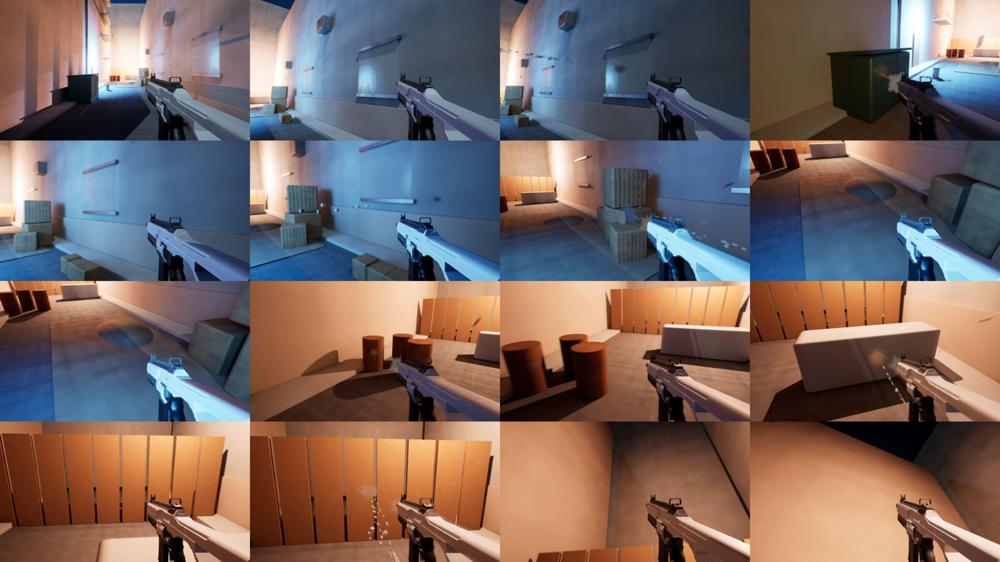
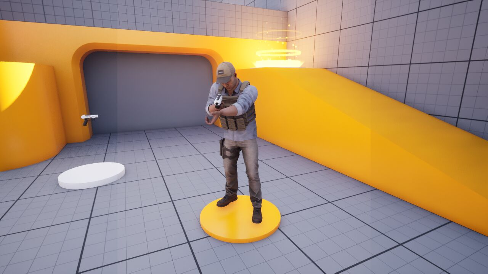
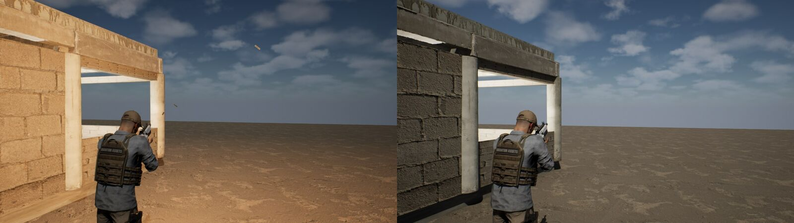
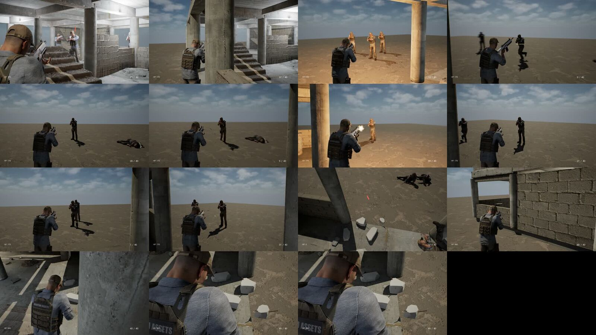

안녕하세요. 이번 글에서는 제가 **AI 게임 스튜디오**를 차리고, 첫 이틀 동안 언리얼 엔진 5.8로 슈터 데모 **UrbanStrike**를 만든 과정을 정리해 보려고 합니다.

방식은 조금 특이합니다. 저는 게임 회사의 CEO 역할만 맡고, 기획·제작·테스트는 AI 팀장 에이전트들이 나눠서 합니다. 저는 방향을 정하고, 보고를 받고, 중요한 순간에 승인 도장을 찍습니다. 스튜디오의 조직도와 제작 파이프라인은 다음 글에서 자세히 다루고, 이번 글은 **실제로 게임이 만들어진 과정**과 **중간에 터진 문제를 어떻게 풀었는지**에 집중하겠습니다.

<video controls playsinline preload="metadata" src="/NeoDevBlog/videos/2026-10-27-us-vslice-v002-720p.mp4"></video>

*확인 영상 v002 (60초). 실제 총기 녹음 사운드가 들어간 두 번째 버티컬 슬라이스 테스트입니다.*

## 한눈에 보기

| 항목 | 내용 |
| --- | --- |
| 엔진 | Unreal Engine 5.8.3 (Lumen, Nanite, 블루프린트 + 에디터 Python) |
| 목표 | 포트폴리오 영상용 사격 쇼케이스, 11월 9일 버티컬 슬라이스 승인 |
| 이틀 결과 | FPS 데모 → 디비전 스타일 TPS 전환, 적 AI 전투, 실내 맵, 시네마틱 2편, 확인 영상 |
| 시간 | 시계로 약 41시간 중 실제 작업은 약 18시간 15분 |
| 가장 긴 대기 | 사운드 라이선스 승인 3시간 31분, 총성 청감 확인 6시간 24분 |

## 1. 질문 다섯 개로 시작했습니다

처음 AI가 던진 열린 질문 4개는 생각보다 답하기 어려웠습니다. 그래서 "객관식으로 다시 질문해 주세요"라고 했더니, 카드 5장으로 범위가 금방 정해졌습니다. 포트폴리오 영상용, 사격 쇼케이스, 블루프린트 위주, 기간 1~2주입니다.

프로젝트 이름은 후보 5개 중 1번, **UrbanStrike**로 정했습니다. 템플릿 무기가 스펀지 공을 쏘고 있어서 히트스캔 사격, 우클릭 조준(FOV 90→55), 재장전, 반동을 새로 붙였고, **약 4시간 만에** 총구 화염·예광탄·탄피·표면 5종 피격 FX와 40초짜리 골목 쇼케이스까지 나왔습니다.

> 💡 **배운 점:** AI에게는 질문 형식이 결과를 바꿉니다. 계획이 정해지면 "계속 묻지 말고 진행해 주세요"가 속도를 크게 올립니다.

## 2. FPS에서 디비전 스타일 TPS로

적이 마네킹이라 무료 군인 캐릭터를 찾았고, 실내 맵용으로 미완성 건물 에셋도 골랐습니다. 이때 저는 밖에 있었는데, AI는 비밀번호를 입력할 수 없고 Launcher 승인도 PC 앞에서만 가능했습니다. 결국 브라우저에 저장된 로그인으로 FBX를 받는 우회로를 찾았습니다.

그리고 가장 큰 방향 전환이 있었습니다. "카메라를 디비전처럼 3인칭으로 바꿔 주세요." 레퍼런스 영상에서 4프레임을 뽑아 캐릭터 위치와 카메라 거리를 숫자로 바꿨고, 결과는 오른쪽 어깨 2.6m·FOV 70, 조준하면 1m·FOV 55입니다. 앉기와 엄폐, 조준하면 일어서서 쏘는 동작도 넣었습니다.

> 💡 **배운 점:** 레퍼런스는 "느낌"이 아니라 프레임 단위 수치로 바꿔야 쓸 수 있습니다.

## 3. 🔥 주요 이슈 ① 적이 움직이지 않았습니다

새 실내 맵에서 적이 제자리에 서서 바닥만 쐈고, 제 총알은 적을 통과했습니다. 처음에는 AI 두뇌(StateTree)를 의심했지만 정상이었습니다. 원인은 모두 기반 쪽에 있었습니다.

> 🔧 **해결법**
> 1. **빈 NavMesh** — 스크립트로 만든 내비 경계 볼륨의 크기가 0이었습니다. 정상 맵의 볼륨을 복사하고, 에디터가 한가할 때 내비를 다시 빌드했습니다.
> 2. **총알이 캐릭터를 통과** — 캐릭터가 피격 트레이스 채널을 무시하고 있었습니다. 벽과 캐릭터 모두 맞도록 충돌 채널을 고쳤습니다.
> 3. **적이 바닥을 쏨** — 조준 각도(pitch)가 플레이어를 따라가지 않았습니다. 몸통을 조준하도록 바꿨습니다.

세 가지를 고치자 플레이어 HP가 500에서 50까지 깎였습니다. 적이 드디어 제대로 싸우기 시작한 거죠. 이어서 피, 둔탁음, 피격 반응, 래그돌, 명중률 조정을 넣었습니다.

> 💡 **배운 점:** 복잡해 보이는 부분보다 기본값(크기 0, 충돌 채널)부터 의심합니다.

## 4. 🔥 주요 이슈 ② 바닥에서 나오는 총알

총알 FX가 바닥과 허공에서 튀어나왔고, 화면 한쪽에는 소총이 둥둥 떠 있었습니다. 범인은 **영상 촬영용으로 맵에 세워 둔 시네마틱 카메라 총**이었습니다. 촬영할 때만 쏴야 하는데 일반 플레이 중에도 계속 쏘고 있었습니다.

> 🔧 **해결법:** 촬영용 액터는 시퀀서 카메라가 켜져 있을 때만 동작하도록 조건을 걸었습니다. 촬영용 장치는 게임플레이와 반드시 분리해야 합니다.

이후에도 FX 문제가 이어졌습니다.

| 증상 | 해결 |
| --- | --- |
| 불꽃이 총알처럼 한 줄로 늘어남 | 55~60° 랜덤으로 퍼지고 0.1~0.35초 만에 사라지게 |
| 군인 총구 화염이 32~109cm 어긋남 | 월드 좌표 대신 무기 소켓에 부착, 120발 중 어긋남 0 |
| 탄피가 공중에서 사라짐 | 수명 3~4.5초, 중력·충돌 순서 수정, 바닥에 1~3번 튕기게 |
| 탄피가 3인칭 거리에서 안 보임 | 실제 크기(0.9×4.2cm)를 1.5배로 키움 |

## 5. 🔥 주요 이슈 ③ 메모리 크래시 7번

Niagara FX v2를 스크립트로 만드는 도구가 화면 없는 실행(헤드리스)에서 계속 죽었습니다. 크래시 폴더가 46개나 쌓였고, 1~2분 간격으로 같은 접근 위반(`EXCEPTION_ACCESS_VIOLATION 0x0`)이 반복됐습니다.

단계를 쪼개서 하나씩 실행하는 이분 탐색과, 마지막 호출을 기록하는 추적 로그로 원인을 좁혔습니다.

> 🔧 **해결법**
> - **원인 1:** 이미 있는 Niagara 에셋을 지우고 같은 경로에 다시 만들어 저장하면 엔진 안에서 죽었습니다. → 에셋 삭제 함수 대신 파일을 직접 지우고 에셋 레지스트리를 다시 스캔하도록 바꿨습니다.
> - **원인 2:** 빌드 직후 스택 경고를 읽는 호출(`GetStackIssues`)이 하드 크래시를 냈습니다. Python 예외가 아니라서 try/except로도 못 막습니다. → 기본값에서 끄고, 필요할 때만 켜도록 바꿨습니다.
> - **결과:** 전체 5개 시스템 실행에서 크래시 0. 다만 엔진 버그를 고친 것이 아니라 위험한 호출을 피한 **우회**라서, 엔진 업데이트 뒤에는 다시 시험합니다.
> - **규칙:** 같은 크래시가 **2번** 나면 재시도를 멈추고 로그부터 봅니다. 이번에는 7번까지 가서야 멈췄기 때문에, 이 규칙을 스튜디오 공통 규칙으로 만들었습니다.

## 6. 🔥 주요 이슈 ④ 에디터 충돌과 승인의 벽

AI 팀장 두 명이 언리얼 에디터 하나를 동시에 쓰다가, 한쪽 작업이 다른 쪽 파일을 덮어쓰는 사고가 났습니다.

> 🔧 **해결법:** `editor.lock` 잠금 파일을 만들어 **한 번에 한 팀만** 에디터에 쓰도록 했습니다. 쓰기 범위도 팀별로 나눴고, 에디터를 닫았다 열지 않고 이미 열린 에디터 안에서 원격으로 스크립트를 실행하게 바꿔 대기 시간도 줄였습니다.

사람 승인이 필요한 곳에서는 몇 시간씩 멈추기도 했습니다. 라이선스·다운로드 승인은 카드를 누르는 것으로는 통과되지 않았고, 제가 직접 문장을 써야 통과했습니다. 이 부분은 다음 글에서 자세히 이야기하겠습니다.

## 7. 확인 영상 하나에 7번

버티컬 슬라이스 확인 영상을 뽑는 데 7번 시도했습니다. 빈 화면(0×0)으로 녹화되기도 하고, 초당 11프레임이 나오기도 하고, 캐릭터가 11초마다 죽기도 했습니다. 전체 화면 녹화 후 자르기, GPU 캡처, 창 크기 고정으로 하나씩 풀어서 79초짜리 v001이 나왔고, 실제 총기 녹음을 넣은 v002까지 만들었습니다.

소리는 AI가 직접 들을 수 없어서 제가 듣고 판단했습니다. 처음 합성한 총성은 아쉬워서 실제 총기 녹음(Sonniss AK5·SVD)으로 바꿨습니다.

> 💡 **배운 점:** 사람만 할 수 있는 일(관리자 승인, 청감 확인, PC 비워 두기)은 한 번에 모아서 요청하는 편이 훨씬 빠릅니다.

## 8. 사격 훈련장에서 테스트 중입니다

마지막으로 Blender에서 스크립트로 52×32m 사격 훈련장을 만들어 언리얼로 옮겼습니다. 사격 레인 5개(7·15·25·40m), 표면 테스트 벽 5종, 방 4개짜리 킬하우스가 있고, 지금은 여기서 표면별 피탄 FX를 하나씩 테스트하고 있습니다.

## 다음 할 일

- 왼손 IK, 표면별 피탄 FX 연결, 애니메이션·FX 우선 작업
- 훈련장 플레이 테스트와 성능 측정 (목표: RTX 5080 기준 120fps)
- 11월 9일 버티컬 슬라이스 승인

## 아직 작업 중입니다

UrbanStrike는 지금도 만들고 있는 중입니다. 다음 글에서는 이 게임을 만들고 있는 **AI 팀장 14명과 제작 파이프라인**을 자세히 소개하겠습니다. 진행되는 대로 계속 기록해서 올리겠습니다. 읽어 주셔서 감사합니다.
