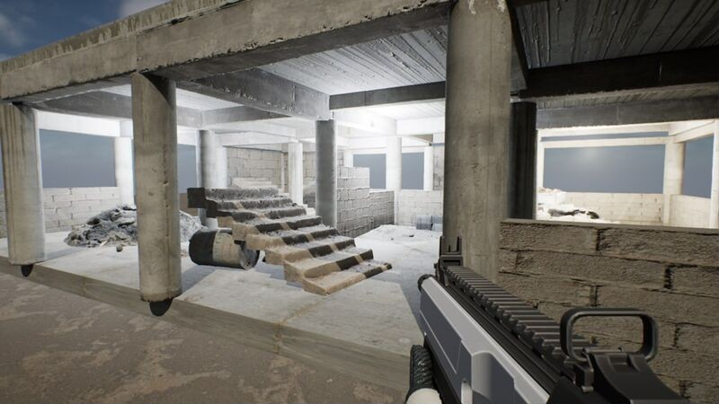
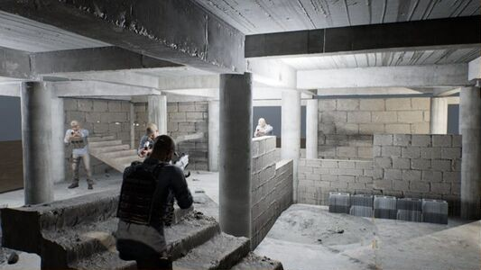
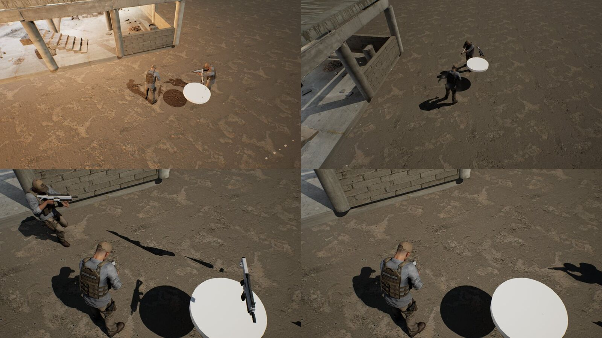
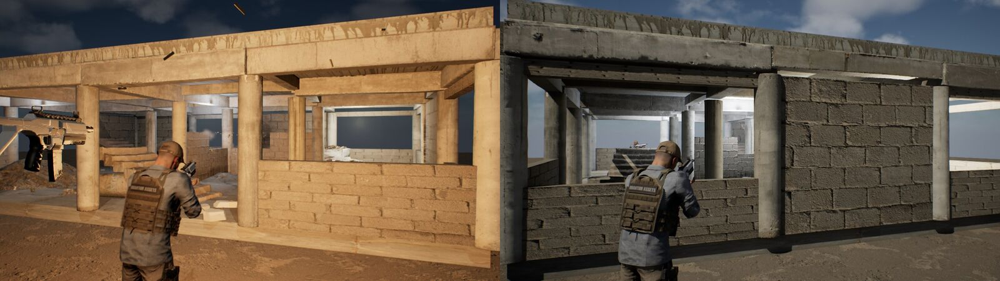
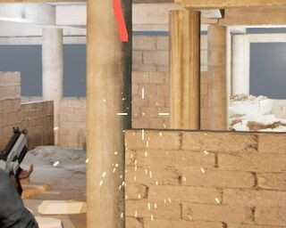
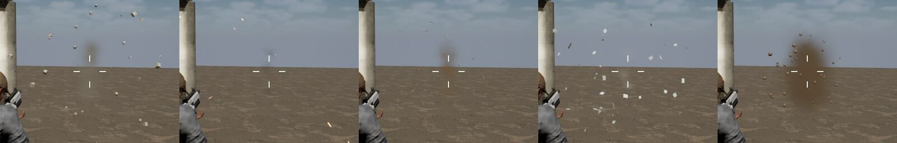
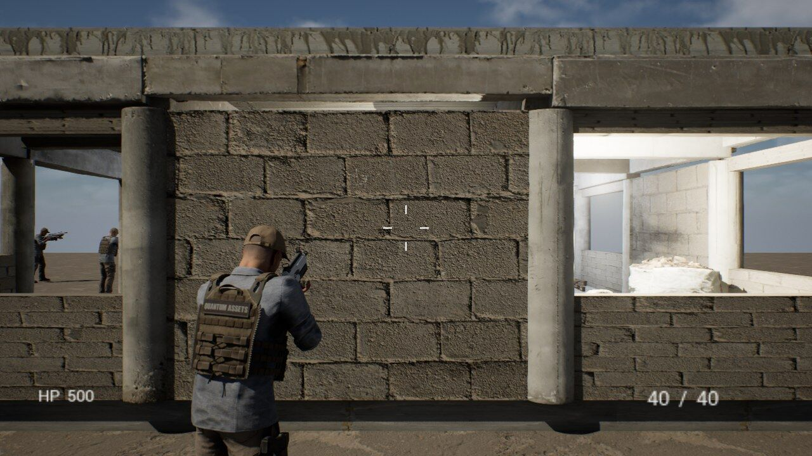
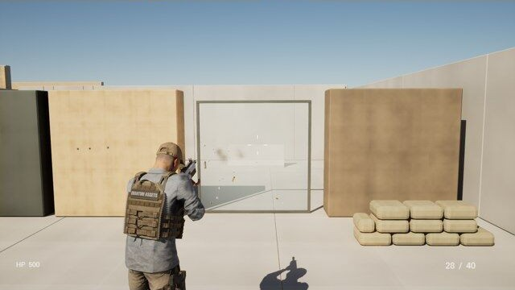

안녕하세요. 이번 글에서는 제가 **AI 게임 스튜디오**를 만들고, 첫 이틀 동안 언리얼 엔진 5.8로 슈터 데모 **UrbanStrike**를 만든 과정을 정리해 보려고 합니다.

미리 말씀드리면 이 글은 "AI가 알아서 게임을 만들어 줬다"는 이야기가 아닙니다. 무엇을 만들지, 어디서 방향을 틀지, 문제가 생겼을때 **제가 방향수정을하고**, AI는 그 결정을 빠르게 실행했습니다. 그래서 이 글도 제가 내린 결정을 중심으로 적었습니다.

## 저는 게임 개발자가 아닙니다

저는 국내와 할리우드 작품을 포함해 10년 넘게 일해 온 **영화 VFX 작업자**입니다. 폭발, 연기, 파편 같은 FX를 주로 만들어 왔고, Houdini를 위주로 영상위주의 작업을 했습니다. 게임이 실제로 어떻게 만들어지는지, 게임 회사가 어떤 단계와 조직으로 굴러가는지는 자세히는 몰랐습니다. 여전히 실제 게임회사에서는 아직 일해 본적이 없고, 경험이 없습니다.

그러다 AI를 연구하면서 **에이전트 하네스**라는 방식을 배웠습니다. 역할이 다른 AI 에이전트 여러 명에게 일을 나눠 맡기고, 규칙과 보고 체계로 묶어서 움직이게 하는 방법입니다. 저는 이 방법을 게임 제작에 응용하기로 했습니다. AI에게 게임 회사의 팀장 역할을 맡기고, 저는 **CEO로서 방향·승인·품질 판단만** 맡는 구조입니다. 원래 처음에는 **언리얼 엔진으로 간단한 게임을 MCP로 만들면서 언리얼 엔진 학습 겸 경험을 목표**로 잡았습니다. 하지만 언리얼 엔진 특성 및 간단하지 않은 첫 FPS게임 만들기를 도전하면서 문제를 해결하기 위해 기존 게임회사의 구조를 참고해서 작업하면 어떨가 생각하고 **에이전트를 이용한 작업 방식으로 계획**하고 전환했습니다.

그때 제가 계획과 설계를 맡기며 입력한 첫 프롬프트는 이렇습니다.

> "게임 제작 파이프라인 계획을 게임회사 팀장들 역할을 에이전트 만들고 하네스로 구성해서 계획하고 설계해줘, 기획부터 퍼블리시 유지보수까지 다 포함"
>
> "나는 게임회사 CEO 역할이고 나머지 제작 업무들은 에이전트들이 설계 실행 하는 식으로 만들어"
>
> "각 중요 단계마다 나한테 보고 후 진행
> - 프로그램 설치 다운로드등은 팀장이 자율적 진행
> - 실행전 계획 후 보고, 계획 실행 후 보고, 실행 중간 10분이상 단계 지연시 보고, 각 작업 단계는 최대한 작게 모듈화 해서 관리 및 문서화"

AI 팀장들이 게임 업계 용어를 너무 많이 써서 처음에는 보고서를 읽기도 어려웠습니다. 그래서 "모르는 용어와 배경지식은 따로 정리해 줘"라고 규칙을 정했고, 그렇게 만든 용어집이 지금은 213개가 넘습니다. 결정을 제대로 하려면 먼저 보고를 이해해야 했기 때문입니다.

> 💡 **개인적인 소감 :** 실제로 작업해 보니 AI로 하는 개발도 생각보다 **기본 지식이 없으면 어렵습니다.** AI가 코드를 대신 써 줘도, 무엇을 시킬지 정하고 결과가 맞는지 판단하려면 엔진 구조, 충돌, 내비게이션 같은 기본 개념을 알아야 했습니다. 언리얼은 기능이 많은 만큼 배울 것도 많아서, 다음에는 **유니티(Unity)나 고도(Godot)처럼 조금 더 간단한 게임 엔진**도 써 볼 생각입니다.

스튜디오의 조직도와 운영 규칙은 다음 글에서 다루고, 이번 글은 **제가 내린 결정**, **방향을 바꾼 순간**, 그리고 **중간에 터진 문제를 어떻게 풀었는지**에 집중하겠습니다.

<video controls playsinline preload="metadata" src="/NeoDevBlog/videos/2026-10-27-us-vslice-v002b-720p.mp4"></video>

*무료 어셋들을 이용한 AI가 만든 테스트 영상 v002*

## 한눈에 보기

| 항목 | 내용 |
| --- | --- |
| 제 역할 | CEO: 범위·방향 결정, 게이트 승인, 화면·소리 확인, 문제 지적 |
| AI의 역할 | 팀장 14명: 계획, 구현, 테스트, 보고 |
| 엔진 | Unreal Engine 5.8.3 (Lumen, Nanite, 블루프린트 + 에디터 Python) |
| 목표 | 포트폴리오 영상용 사격 쇼케이스, 11월 9일 버티컬 슬라이스 승인 |
| 이틀 결과 | FPS 데모 → 디비전 스타일 TPS 전환, 적 AI 전투, 실내 맵, 시네마틱 2편, 확인 영상 |
| 시간 | 시계로 약 41시간 중 실제 작업은 약 18시간 15분 |

## 결정 1. 범위와 작업 방식을 먼저 정했습니다

처음 AI가 던진 열린 질문 4개는 답하기가 어려웠습니다. 그래서 제가 질문 방식부터 바꿨습니다.

> "객관식으로 다시 질문해."

카드 5장으로 범위가 금방 정해졌습니다. 포트폴리오 영상용, 사격 쇼케이스, 블루프린트 위주, 기간 1~2주입니다. 이름도 후보 5개 중 **UrbanStrike**로 골랐습니다. 이어서 작업 방식도 제가 정했습니다.

- "전체 계획을 이어서, 계속 묻지 말고 작업해." → 계획이 정해진 뒤에는 자율 진행
- "실제 프로젝트는 깃허브에 올리지 않고, D 드라이브에서 작업하는 식으로 진행해." → 로컬 git만 사용
- "작업 과정을 나중에 내가 따라 할 수 있도록 제작 튜토리얼 버전으로 분리해서 저장해 줘." → 재제작 튜토리얼 10편

이렇게 틀을 정하고 나니 AI는 **약 4시간 만에** 히트스캔 사격, 조준, 재장전, 반동, 총구 화염·예광탄·탄피·표면 5종 피격 FX, 40초짜리 골목 쇼케이스까지 만들어 냈습니다.

> 💡 **배운 점:** AI에게는 질문 형식과 작업 규칙을 먼저 정해 주는 것이 결과를 바꿉니다. 결정할 것은 제가 정하고, 정해진 뒤에는 묻지 않게 하는 것이 속도의 핵심이었습니다.

## 결정 2. 1인칭을 디비전 스타일 3인칭으로 바꿨습니다

적이 마네킹이라 무료 군인 캐릭터를 고르고, 실내 맵도 원격으로 받을 수 있는 미완성 건물 에셋으로 바꿨습니다.

그리고 이틀 중 가장 큰 방향 전환을 했습니다.

> "테스트 적 발 위치를 바닥에 맞게 배치시키고, 게임 카메라를 디비전 같은 TPS 3인칭 스타일로 수정해 줘."
>
> "이 영상의 3분 구간에 나오는 장면을 참고해서 카메라랑 모션을 작업해."

캐릭터와 엄폐가 보이는 화면이 포트폴리오 영상에 더 맞다고 판단했기 때문입니다. AI는 제가 지정한 레퍼런스 구간에서 4프레임을 뽑아 캐릭터 위치와 카메라 거리를 숫자로 바꿨습니다. 결과는 오른쪽 어깨 2.6m·FOV 70, 조준하면 1m·FOV 55입니다.

> 💡 **배운 점:** "느낌"으로 말하는 대신 레퍼런스의 정확한 구간을 짚어 주면, AI가 그것을 수치로 바꿔 줍니다.

## 결정 3. 🔥 적이 움직이지 않을 때, 어디를 볼지 정했습니다

새 실내 맵에서 적이 제자리에 서서 바닥만 쐈고, 제 총알은 적을 통과했습니다. AI는 처음에 AI 두뇌(StateTree)를 의심했지만 정상이었습니다. 그래서 제가 조사 방향을 바꿨습니다.

> "적이 움직이는 조건 및 이벤트 데이터 등을 조사해 봐."

원인은 모두 기반 쪽에 있었습니다.

> 🔧 **해결법**
> 1. **빈 NavMesh** — 스크립트로 만든 내비 경계 볼륨의 크기가 0이었습니다. 정상 맵의 볼륨을 복사하고, 에디터가 한가할 때 내비를 다시 빌드했습니다.
> 2. **총알이 캐릭터를 통과** — 캐릭터가 피격 트레이스 채널을 무시하고 있었습니다. 벽과 캐릭터 모두 맞도록 충돌 채널을 고쳤습니다.
> 3. **적이 바닥을 쏨** — 조준 각도(pitch)가 플레이어를 따라가지 않았습니다. 몸통을 조준하도록 바꿨습니다.

세 가지를 고치자 플레이어 HP가 500에서 50까지 깎였습니다. 적이 드디어 제대로 싸우기 시작한 거죠.

> 💡 **배운 점:** 복잡해 보이는 부분보다 기본 조건부터 보라고 방향을 잡아 주는 것이 사람의 역할이었습니다.

## 결정 4. 🔥 화면에서 이상한 것을 제가 짚었습니다

총알 FX가 바닥과 허공에서 튀어나왔고, 화면 한쪽에는 소총이 둥둥 떠 있었습니다. 테스트는 모두 통과했지만, 화면은 분명히 이상했습니다.

> "총알 이벤트가 총구 끝에서 총구 방향으로만 나오게 하고, 바닥 등 다른 곳에서 나오는 이유를 찾아서 버그 수정해."

범인은 **영상 촬영용으로 맵에 세워 둔 시네마틱 카메라 총**이었습니다. 촬영할 때만 쏴야 하는데 일반 플레이 중에도 계속 쏘고 있었습니다.

> 🔧 **해결법:** 촬영용 액터는 시퀀서 카메라가 켜져 있을 때만 동작하도록 조건을 걸었습니다. 촬영용 장치는 게임플레이와 반드시 분리해야 합니다.

이후 FX도 제가 보고 하나씩 지적했습니다. FX를 오래 만들어 온 눈으로 보면 바로 걸리는 것들이었습니다.

| 제가 한 지적 | AI가 고친 것 |
| --- | --- |
| "총알 반사 이펙트가 랜덤하게 퍼지게 하고 충돌 후 빨리 사라지게 수정해. 디비전 레퍼런스 영상을 참고해서." | 불꽃이 55~60° 랜덤으로 퍼지고 0.1~0.35초 만에 사라지게 |
| "벽에서 나오는 총알 같은 모션을 확인하고, 총알이면 제거, 먼지 같은 인터랙션이면 퍼지게 수정해." | FX 종류별로 처리 기준을 나눔 |
| "탄피가 바닥에 떨어지게 수정해." | 수명 3~4.5초, 중력·충돌 순서 수정, 바닥에 1~3번 튕기게 |
| 적 총구 화염이 총에서 떨어져 보임 | 월드 좌표 대신 무기 소켓에 부착, 120발 중 어긋남 0 |

> 💡 **배운 점:** 코드를 몰라도 "불꽃이 너무 오래 남는다", "총알이 엉뚱한 데서 나온다"를 정확히 말하면 원인 찾기와 수정은 AI가 해냅니다. 이상한 것을 알아보는 눈은 제 몫이었습니다.

## 결정 5. 🔥 메모리 크래시 7번 끝에 "멈춤" 규칙을 만들었습니다

Niagara FX v2를 스크립트로 만드는 도구가 화면 없는 실행(헤드리스)에서 계속 죽었습니다. 크래시 폴더가 46개나 쌓였고, 1~2분 간격으로 같은 접근 위반(`EXCEPTION_ACCESS_VIOLATION 0x0`)이 반복됐습니다. AI는 같은 시도를 계속 반복했고, 저는 일정부터 물었습니다.

> "FX 작업에 하루나 걸리는 이유가 뭐야?"
>
> "알았어. 콘크리트 피탄 작업 먼저 해서 보여 줘."

큰 작업을 쪼개 하나부터 확인하게 하자, 단계를 나눠 실행하는 이분 탐색과 마지막 호출을 기록하는 추적 로그로 원인이 좁혀졌습니다.

> 🔧 **해결법**
> - **원인 1:** 이미 있는 Niagara 에셋을 지우고 같은 경로에 다시 만들어 저장하면 엔진 안에서 죽었습니다. → 에셋 삭제 함수 대신 파일을 직접 지우고 에셋 레지스트리를 다시 스캔하도록 바꿨습니다.
> - **원인 2:** 빌드 직후 스택 경고를 읽는 호출(`GetStackIssues`)이 하드 크래시를 냈습니다. Python 예외가 아니라서 try/except로도 못 막습니다. → 기본값에서 끄고, 필요할 때만 켜도록 바꿨습니다.
> - **결과:** 전체 5개 시스템 실행에서 크래시 0. 다만 엔진 버그를 고친 것이 아니라 위험한 호출을 피한 **우회**라서, 엔진 업데이트 뒤에는 다시 시험합니다.

그리고 같은 일이 반복되지 않도록 제가 규칙을 걸었습니다.

> "크래시가 반복되면 메모리 버그 확인 등 디버깅 절차를 하네스에 추가해."

이제 같은 크래시가 **2번** 나면 팀장들은 재시도를 멈추고 로그부터 봅니다. 이 절차는 다음 글에서 자세히 정리했습니다.

## 결정 6. 🔥 에디터 충돌과 승인 대기를 규칙으로 막았습니다

AI 팀장 두 명이 언리얼 에디터 하나를 동시에 쓰다가, 한쪽 작업이 다른 쪽 파일을 덮어쓰는 사고가 났습니다.

> 🔧 **해결법:** `editor.lock` 잠금 파일로 **한 번에 한 팀만** 에디터에 쓰도록 하는 규칙을 승인했습니다. 쓰기 범위도 팀별로 나눴고, 이미 열린 에디터 안에서 원격으로 스크립트를 실행하게 바꿔 대기 시간도 줄였습니다.

사람 승인이 필요한 곳에서는 몇 시간씩 멈추기도 했습니다. 제가 PC 앞에 없어서 작업이 멈춰 있던 것을 보고 이렇게 말했습니다.

> "작업 안 하고 뭐 해? 앞으로 내가 확인해야 할 게 있으면 미리 알려줘."

그 뒤로 PC를 켜 두거나 승인을 눌러야 하는 일처럼 **사람이 할 일은 미리 모아서** 알려 주도록 바뀌었습니다.

## 결정 7. 소리는 제가 듣고 판단했습니다

버티컬 슬라이스 확인 영상을 뽑는 데 7번 시도했습니다. 빈 화면(0×0)으로 녹화되기도 하고, 초당 11프레임이 나오기도 하고, 캐릭터가 11초마다 죽기도 했습니다. 전체 화면 녹화 후 자르기, GPU 캡처, 창 크기 고정으로 하나씩 풀어서 v001이 나왔습니다.

AI는 소리를 들을 수 없습니다. 그래서 총성은 제가 직접 듣고 판단했고, 처음 합성한 총성이 아쉬워서 **실제 총기 녹음(Sonniss AK5·SVD)으로 바꾸기로 결정**했습니다. 위의 v002 영상이 그 결과입니다.

> 💡 **배운 점:** 사람만 할 수 있는 일(관리자 승인, 청감 확인, PC 비워 두기)은 한 번에 모아서 요청하는 편이 훨씬 빠릅니다.

## 결정 8. 테스트용 사격 훈련장을 직접 만들게 했습니다

기존 맵에서는 표면·거리별로 하나씩 검증하기가 어려웠습니다.

> "게임 배경으로 블렌더에서 간단한 모델링으로 총기 테스트 훈련장을 직접 만들어 가져오는 방법을 계획해 줘."

그래서 Blender에서 스크립트로 52×32m 사격 훈련장을 만들어 언리얼로 옮겼습니다. 사격 레인 5개(7·15·25·40m), 표면 테스트 벽 5종, 방 4개짜리 킬하우스가 있고, 지금은 여기서 표면별 피탄 FX를 하나씩 테스트하고 있습니다.

## 제가 바꾼 방향과 컨셉

CEO로서 제가 한 가장 중요한 일은 코드를 쓰는 것이 아니라 **방향을 바꾸는 결정**이었습니다. 이틀 동안 바꾼 것들을 모아 보면 이렇습니다.

| 언제 | 처음 계획 | 바꾼 방향 | 이유 |
| --- | --- | --- | --- |
| 첫날 오전 | 열린 질문으로 계획 | 객관식 카드로만 질문 | 답하기 쉽고 결정이 빨라짐 |
| 첫날 오전 | 단계마다 확인 | "계속 묻지 말고 진행" | 계획이 정해진 뒤에는 속도가 우선 |
| 첫날 오전 | GitHub에 프로젝트 저장 | 로컬 드라이브 + 로컬 git만 | 대용량 프로젝트, 외부 공개 방지 |
| 첫날 오전 | 결과물만 만들기 | 제가 따라 만들 수 있는 튜토리얼 버전 분리 | 나중에 직접 다시 만들며 배우기 위해 |
| 첫날 오후 | Old Power Plant 실내 맵 | Unfinished Building | 원격으로 받을 수 있는 FBX 형식 |
| 첫날 오후 | 콜 오브 듀티식 1인칭(FPS) | 디비전식 어깨 너머 3인칭(TPS) | 캐릭터와 엄폐가 보이는 화면이 영상에 유리 |
| 둘째 날 | AI 혼자 작업 | 팀장 14명의 AI 게임 스튜디오, 저는 CEO | 기획부터 출시·유지보수까지 체계적으로 |
| 둘째 날 | Houdini Engine 연동 FX | 파일 기반 → 보류 → **Niagara 직접 제작** | 버전 지원 범위, 라이선스 |
| 둘째 날 | 외부 에셋 위주 | Blender·Niagara로 직접 만드는 파이프라인 | 포트폴리오에 쓸 수 있는 내 소스 |
| 둘째 날 | 합성 총성 | 실제 총기 녹음 | 직접 들어 보고 부족하다고 판단 |
| 둘째 날 | 성능 목표 없음 | RTX 5080 기준 120fps | 실제 게임 수준의 기준 필요 |
| 둘째 날 밤 | 기존 맵에서 테스트 | Blender로 직접 만든 사격 훈련장 | 표면·거리별로 하나씩 검증하기 위해 |

영화 VFX에서는 감독이 정한 샷 하나를 끝까지 완성하는 데 익숙했는데, 게임에서는 **범위를 줄이고, 막히면 돌아가는 결정**이 훨씬 자주 필요했습니다. 그 결정을 내리는 자리에 앉아 본 것이 이번 이틀의 가장 큰 수확입니다.

## 제 결정 기록은 웹 콘솔로 봅니다

결정과 진행 상황은 AI 팀장들이 웹 페이지로 정리해 둡니다. 지금 단계와 게이트, 공정별 테스트 결과, 스프린트 보드, 그리고 제가 내린 결정 기록을 한 화면에서 볼 수 있습니다.

**이 콘솔은 작업중간 확인용으로 문서화 작업을 하면서 AI를 이용해 웹용으로 만들어 달라고 했습니다.**

- [UrbanStrike 스튜디오 콘솔](/NeoDevBlog/docs/urbanstrike-studio-console.html) (2026-10-27 스냅샷)

## 다음 할 일 / To do list 로 작업목록입니다.

- 왼손 IK, 표면별 피탄 FX 연결, 애니메이션·FX 우선 작업
- 훈련장 플레이 테스트와 성능 측정 (목표: RTX 5080 기준 120fps)
- 11월 9일 버티컬 슬라이스 승인

## 아직 많이 부족해서 추가로 작업 중입니다

UrbanStrike는 지금도 만들고 있는 중입니다. 다음 글에서는 제가 이 스튜디오를 어떤 규칙으로 운영하는지, **AI 팀장 14명과 제작 파이프라인**을 자세히 소개하겠습니다. 진행되는 대로 계속 기록해서 올리겠습니다. 긴 글 읽어 주셔서 감사합니다.
