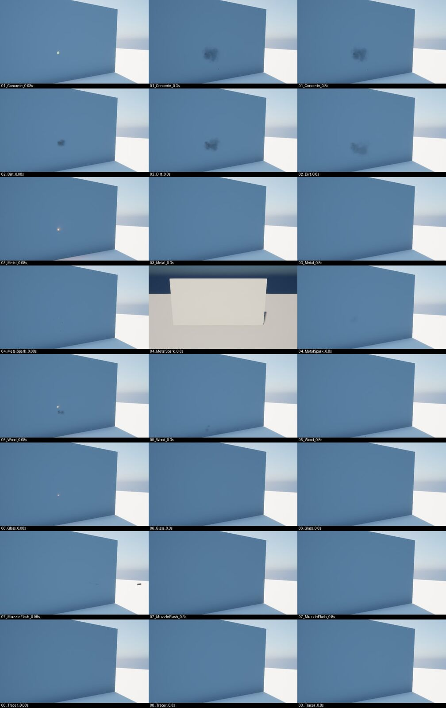
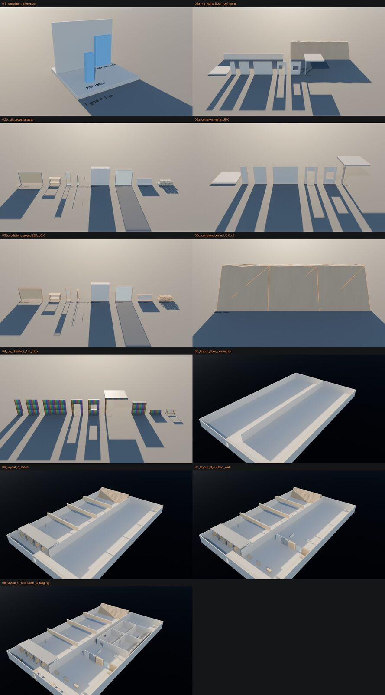

[지난 글](../2026-10-27-ai-game-studio/)에서는 AI 게임 스튜디오로 UrbanStrike를 만든 첫 이틀을 소개했습니다. 이번 글에서는 그 스튜디오가 **어떻게 짜여 있는지**, 그리고 에셋이 **어떤 길을 거쳐 게임에 들어가는지** 정리해 보겠습니다.

## 시작은 한 문장이었습니다

> "나는 게임 회사 CEO 역할이고, 나머지 제작 업무는 에이전트들이 설계·실행하는 식으로 만들어 주세요."

이 한 문장에서 하루 만에 팀장 14명, 7단계 제작 과정, 6개 게이트, 보고 규칙이 만들어졌습니다. 규칙은 처음에 다 정하지 않았고, 문제가 생길 때마다 하나씩 추가했습니다.

### 왜 이런 방식을 택했나요

저는 10년 넘게 영화 VFX만 해 온 사람이라 게임 회사가 어떻게 돌아가는지 몰랐습니다. 대신 AI를 공부하면서 **에이전트 하네스**를 배웠고, 이미 AI 기술 리서치와 Houdini VFX 작업에 하네스를 만들어 써 보고 있었습니다. 역할별 에이전트, 단계별 승인, 작업 기록이라는 같은 틀을 게임 회사 조직에 맞춰 옮긴 것이 이번 스튜디오입니다.

모르는 분야를 직접 다 배우고 시작하는 대신, **회사 구조 자체를 AI에게 기획하게 하고 저는 결정만 하는 쪽**을 택했습니다. 대신 결정을 제대로 하려면 보고서를 이해해야 했습니다.

### 용어집부터 만들었습니다

첫 보고서를 받았을 때 스프린트, 티켓, QA, BR, S1, G1 같은 약어가 쏟아졌습니다. AI는 당연하게 쓰는 말이지만 저에게는 낯선 말이었습니다. 그래서 두 가지 규칙을 정했습니다.

- 약어는 항상 영어 원문과 설명을 괄호로 함께 쓰기. 예: QA(Quality Assurance, 품질 테스트)
- 제가 모르는 기본 단어와 배경지식은 용어집으로 따로 정리하기

그렇게 만든 용어집이 213개가 넘었고, S0~S6 같은 단계 이름은 위키백과, Unity 교육 자료, Game Developer, 『The Game Production Handbook』 등 출처 5곳과 맞춰 봤습니다. 참고로 S0~S6라는 번호는 업계 표준이 아니라 우리 스튜디오가 붙인 라벨입니다. 운영이 처음이라면 이 방법을 꼭 추천드립니다.

## 팀장 에이전트 14명

| 약어 | 역할 | 하는 일 |
| --- | --- | --- |
| PD | Producer, 제작 총괄 | 스프린트 계획, 티켓 배정, CEO 보고 |
| GD | Game Design, 게임 디자인 | 기획서(GDD), 무기·적 수치 |
| LD | Level Design, 레벨 디자인 | 맵 블록아웃, 동선 |
| AD | Art Director, 아트 총괄 | 스타일 가이드, 아트 리뷰 |
| A3 | 3D Art | Blender 모델링, 에셋 검사 |
| TD | Technical Director, 기술 리드 | 구조, 성능, 크래시 원인 분석 |
| TA | Technical Art | Niagara FX, 셰이더 |
| AN | Animation | 애니메이션, 리타깃 |
| SD | Sound Design | 사운드, MetaSounds |
| UI | User Interface | HUD, 메뉴 |
| QA | Quality Assurance, 품질 테스트 | 자동 테스트, 버그 리포트 |
| BR | Build & Release | 패키지 빌드 |
| PB | Publishing | 영상, 스토어 페이지 |
| LO | Live Ops | 패치, 유지보수 |

팀장끼리는 프로젝트 안의 `Studio/` 폴더에 있는 티켓·핸드오프·게이트 리포트 문서로만 주고받습니다. 덕분에 세션이 끊겨도 다음 세션이 상태 파일을 읽고 바로 이어서 일할 수 있습니다.

## 7단계와 게이트

| 단계 | 하는 일 | 게이트 |
| --- | --- | --- |
| S0 컨셉 | 한 문장 피치, 레퍼런스, 범위 | G0 그린라이트 |
| S1 프리프로덕션 | 기획서, 파이프라인 검증, 버티컬 슬라이스 | G1 버티컬 슬라이스 |
| S2 프로덕션 | 기능 구현, 레벨 블록아웃 | G2 알파 |
| S3 콘텐츠 완성 | 최종 에셋·사운드·애니 | G3 베타 |
| S4 폴리싱·QA | 패키지 빌드, 성능·안정성 | G4 RC |
| S5 출시 | 공개, 업로드 | G5 출시 승인 |
| S6 라이브옵스 | 패치, 유지보수 | P# 패치 게이트 |

게이트 승인은 CEO인 제가 직접 합니다. UrbanStrike는 지금 S1 단계이고, 첫 목표는 11월 9일 G1(버티컬 슬라이스)입니다.

## CEO가 받는 보고

| 보고 | 시점 | 내용 |
| --- | --- | --- |
| 계획 보고 | 실행 전 | 조사한 레퍼런스, 목표, 작업 단위, 예상 시간 |
| 완료 보고 | 실행 후 | 결과물, 통과 여부, 측정값, 스크린샷 |
| 지연 보고 | 10분 초과 | 어디서 막혔는지, 다음 시도, 새 예상 시간 |
| 즉시 알림 | 그때그때 | 승인이나 제 답이 필요할 때 바로 |

작업은 30분 안에 끝나는 작은 단위(모듈)로 쪼개고, 모듈마다 기록을 남깁니다. 새 단계를 시작하기 전에는 반드시 레퍼런스부터 조사합니다. 무료 프로그램 설치나 다운로드는 팀장이 알아서 하고, 결제·계정·라이선스 동의는 제가 결정합니다.

## 회사처럼 역할을 나눴더니 효율적이었습니다

첫날에는 AI 하나와 대화하며 작업했습니다. 기획, 아트, FX, 테스트가 한 대화에 섞이다 보니 "무슨 작업 중이야?"를 12분 동안 세 번 물어도 답이 없던 적도 있었습니다. 실제 게임 회사의 일반적인 구성원 역할대로 에이전트를 나누자 일이 훨씬 잘 굴러갔습니다.

- **책임이 분명합니다.** 버그는 QA가 찾고, 원인은 TD가 보고, FX는 TA가 고칩니다. "누가 하지?"를 제가 정할 필요가 없습니다.
- **병렬로 돌아갑니다.** 서로 겹치지 않는 티켓은 3~4개를 동시에 진행합니다. 첫 스프린트에서는 하루 만에 티켓 12개가 끝났습니다.
- **검증이 여러 겹입니다.** 셀프 체크 → 다른 팀장의 크로스 리뷰 → QA 검증 → PD 판정을 거친 뒤에야 제게 옵니다.
- **세션이 끊겨도 이어집니다.** 모든 일이 티켓·핸드오프 문서로 남아서, 다음 날 새 세션이 상태 파일만 읽고 바로 이어서 일합니다.
- **업계 방식을 몰라도 따라갈 수 있습니다.** 단계·게이트·스프린트 같은 게임 회사의 일하는 방식을 팀장들이 그대로 지켜 주니, 저는 그 틀 안에서 결정만 하면 됩니다.

## 에이전트로 일하는 장점

| 장점 | 실제로 느낀 점 |
| --- | --- |
| CEO는 결정에만 집중 | 저는 방향 전환, 승인, 소리·화면 확인 같은 사람만 할 수 있는 일에 시간을 썼습니다 |
| 규칙 하나로 전체가 바뀜 | "크래시가 2번 나면 멈춰"를 한 번 정하면 14명이 모두 따릅니다 |
| 기록이 자동으로 남음 | 모듈마다 로그가 남아서, 이 블로그 글과 유튜브 대본의 재료가 됐습니다 |
| 모르는 분야도 시작 가능 | 게임 제작을 몰라도 팀장들의 보고와 용어집으로 배우면서 진행했습니다 |
| 실패해도 되돌리기 쉬움 | 30분짜리 모듈 단위라 실패하면 그 모듈만 되돌리고 다시 합니다 |
| 밖에서도 지시 가능 | 제가 밖에 있을 때도 휴대폰으로 지시하면 집 PC에서 작업이 진행됐습니다 |

물론 한계도 있습니다. 관리자 승인, 라이선스 동의, 소리 듣기처럼 사람만 할 수 있는 일에서는 여전히 기다림이 생깁니다. 그래서 이런 일은 한 번에 모아서 요청하도록 규칙을 바꿨습니다.

## 스튜디오 규칙을 만든 제 프롬프트

스튜디오의 규칙은 대부분 제가 중간에 문제를 보고 입력한 한 줄에서 생겼습니다. (오타와 띄어쓰기만 고쳤습니다.)

| 제가 입력한 프롬프트 | 생긴 규칙 |
| --- | --- |
| "게임회사 팀장 역할을 하는 에이전트를 만들고 하네스로 구성해서 계획·설계해 줘. 기획부터 퍼블리시, 유지보수까지 모두 포함." | 팀장 14명, S0~S6, G0~G5 |
| "나는 게임회사 CEO 역할이고, 나머지 제작 업무는 에이전트들이 설계·실행하는 식으로 만들어." | CEO 권한과 위임 범위 |
| "중요 단계마다 나에게 보고한 뒤 진행해. 실행 전 계획 보고, 실행 후 보고, 실행 중 10분 이상 지연되면 보고. 작업 단계는 최대한 작게 모듈화해서 관리·문서화해." | 보고 3종, 30분 모듈 |
| "S1 등 약어는 영어 원문도 괄호 안에 함께 표시해. 나는 운영이 처음이라 모르는 단어가 많으니 필요한 기본 단어나 배경지식도 따로 정리해." | 약어 표기 규칙, 용어집 213개 |
| "앞으로 작업할 때 새 단계는 관련 레퍼런스 등을 조사한 뒤 진행해." | 레퍼런스 먼저 조사 |
| "후디니 라이선스 작업은 보류하고, FX 작업은 우선 언리얼 나이아가라 등으로 자체 제작하도록 계획을 바꾼 뒤 진행해." | FX는 Niagara 직접 제작 |
| "크래시가 반복되면 메모리 버그 확인 등 디버깅 절차를 하네스에 추가해." | 크래시 대응 절차 |
| "게임 최적화 과정이 있는지 확인하고, 없으면 RTX 5080 기준 120fps를 목표로 설정해." | 성능 목표와 프레임 예산 |
| "앞으로 작업이 완료되거나, 중간에 승인이 필요하거나, 내 답이 필요하면 바로 보여 줘." | 즉시 알림 규칙 |
| "앞으로 중간에 필요한 작업 권한은 너한테 있어. 중간에 결과 보고만 잘해 줘." | 권한 위임 |

## 🔥 운영하면서 부딪힌 벽과 해결법

### 1. AI는 자기 설정을 고칠 수 없습니다

> 🔧 **해결법:** 에이전트 설정 폴더(`.claude`)는 안전 규칙 때문에 AI가 직접 쓸 수 없습니다. 그래서 AI가 수정본과 적용 스크립트를 만들고, 제가 명령 한 줄만 실행하는 방식으로 바꿨습니다.

### 2. 승인은 사람이 직접 쓴 문장만 통과합니다

> 🔧 **해결법:** 라이선스·다운로드처럼 되돌리기 어려운 일은 카드를 누르는 것으로는 통과되지 않았습니다. 처음부터 "이렇게 써 주세요"라고 승인 문장을 보여 주고, 제가 직접 입력하도록 바꿨더니 바로 풀렸습니다. 이 일로 3시간 31분을 기다렸습니다.

### 3. 에디터 한 대를 두 팀이 쓰면 사고가 납니다

> 🔧 **해결법:** 두 팀이 동시에 에디터를 쓰다가 잔해 에셋 파일이 덮어써졌습니다. `editor.lock` 파일로 한 번에 한 세션만 에디터에 쓰게 하고, 팀별 쓰기 범위를 나눴습니다. 잠금을 기다리는 동안에는 다른 독립 작업을 병렬로 진행합니다.

### 4. 같은 크래시가 두 번 나면 멈춥니다

FX 도구가 헤드리스 실행에서 7번 크래시가 난 뒤, 크래시 대응 절차를 스튜디오 규칙에 넣었습니다.

> 🔧 **크래시 대응 절차**
> 1. **멈춤** — 같은 크래시가 2번 나면 재시도하지 않고 잠금을 풉니다.
> 2. **수집** — 크래시 폴더, 로그, 실행 명령, 마지막 성공 커밋을 모읍니다.
> 3. **분류** — 널 접근, Assert, 메모리 부족, GPU, 헤드리스 전용으로 나눕니다.
> 4. **메모리 확인** — `stat memory`, `memreport -full`로 추이를 봅니다.
> 5. **최소 재현** — 단계를 쪼개 이분 탐색으로 원인 줄을 좁힙니다.
> 6. **우회와 근본 해결 분리** — 우회책은 따로 표시하고 근본 해결 티켓을 엽니다.
> 7. **회귀 테스트** — 고친 크래시는 자동 테스트에 넣어 다시 나오지 않는지 매번 확인합니다.

## 에셋 제작 파이프라인

외부 에셋에서 직접 만든 소스로 넘어가기 위해 무료 툴 중심으로 파이프라인을 짰습니다.

| 분야 | 툴 | 언리얼로 가는 길 |
| --- | --- | --- |
| 모델링 | Blender 5.2 (포터블) | Send2UE 원클릭 전송, 충돌·Nanite 자동 설정 |
| 텍스처 | Material Maker, Krita | 이름 규칙(T_, M_, MI_) |
| FX | 언리얼 Niagara 직접 제작 | `_v2` 시스템을 Python으로 생성 |
| 연기·먼지 | Blender Mantaflow | 플립북 텍스처로 구워서 Niagara에 |
| 사운드 | Audacity, Sonniss 무료 번들 | MetaSounds |

관리자 승인 창(UAC)은 원격에서 누를 수 없어서, Blender는 설치가 필요 없는 포터블 버전을 썼습니다. Houdini는 버전 지원 범위와 라이선스 문제로 방향이 세 번 바뀌었고, 결국 **FX는 언리얼 Niagara로 직접 만들기**로 정리했습니다. 막힌 일은 보류하고 대체 경로로 가니 스프린트가 멈추지 않았습니다.

### 사례: Blender로 만든 사격 훈련장

52×32m 훈련장을 Blender에서 스크립트로 만들었습니다. 템플릿 → 1m 격자 모듈 18종 → 충돌 → UV → 배치 순서로 진행했고, 단계마다 캡처를 남겼습니다.

Send2UE로 언리얼에 옮긴 모듈 18종입니다.

## 성능 목표: RTX 5080에서 120fps

처음에는 "1080p 60fps" 한 줄뿐이었는데, 측정 도구와 예산을 갖춘 과정으로 바꿨습니다.

- 기준: RTX 5080, 1440p Epic 품질, 평균 120fps(프레임당 8.33ms), 1% low 90fps 이상
- 예산: GPU 합계 8ms 안에서 Lumen 2.5ms, 그림자 1.2ms, FX 0.5ms 등으로 나눔
- 측정: S1부터 매 스프린트

훈련장에서 처음 잰 값은 프레임 8.66ms, GPU 4.86ms였습니다. GPU는 여유가 있고, 지금은 게임 스레드(8.61ms)가 병목이라 다음 최적화 대상입니다. 에디터 안에서 잰 값이라 패키지 빌드에서 다시 측정할 예정입니다.

## 아직 작업 중입니다

스튜디오 규칙도, 파이프라인도 아직 다듬는 중입니다. 새 문제가 생기면 규칙이 하나씩 늘어날 거고, 그 과정도 계속 기록하겠습니다. 다음에는 버티컬 슬라이스(G1)를 향해 가는 과정을 들고 오겠습니다. 읽어 주셔서 감사합니다.
