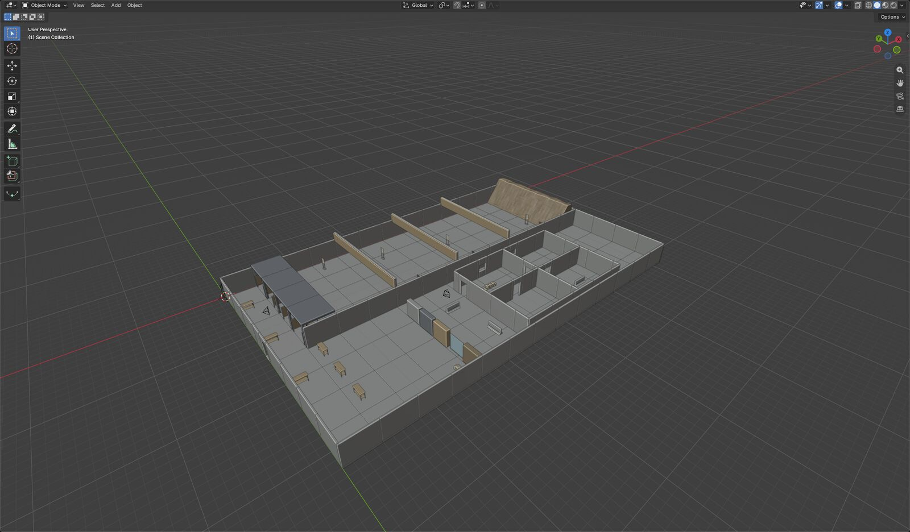
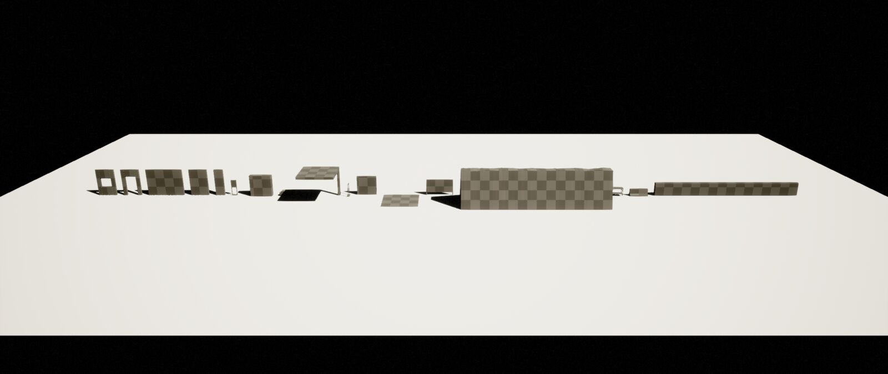
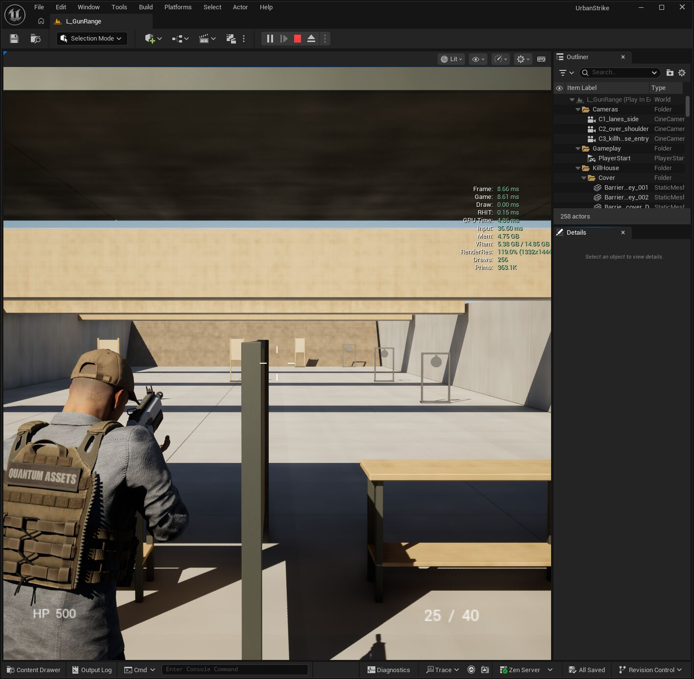

[지난 글](../2026-10-27-ai-game-studio/)에서는 AI 게임 스튜디오로 UrbanStrike를 만든 첫 이틀을 소개했습니다. 이번 글에서는 그 스튜디오를 **제가 어떤 규칙으로 운영하는지**, 그리고 에셋이 **어떤 길을 거쳐 게임에 들어가는지** 정리해 보겠습니다.

스튜디오의 조직과 규칙은 AI가 짰지만, 그 조건은 모두 제가 걸었습니다. 누가 무엇을 결정하는지, 언제 보고하는지, 무엇이 실패면 멈추는지를 정한 것이 이번 작업에서 제가 가장 많이 한 일입니다.

## 시작은 제 두 문장이었습니다

> "게임회사 팀장 역할을 하는 에이전트를 만들고 하네스로 구성해서 계획·설계해 줘. 기획부터 퍼블리시, 유지보수까지 모두 포함."
>
> "나는 게임회사 CEO 역할이고, 나머지 제작 업무는 에이전트들이 설계·실행하는 식으로 만들어."

이 두 문장에서 하루 만에 팀장 14명, 7단계 제작 과정, 6개 게이트, 보고 규칙이 만들어졌습니다. 규칙은 처음에 다 정하지 않았고, 운영하면서 문제가 보일 때마다 제가 하나씩 추가했습니다.

### 왜 이런 방식을 택했나요

저는 10년 넘게 영화 VFX만 해 온 사람이라 게임 회사가 어떻게 돌아가는지 몰랐습니다. 대신 AI를 공부하면서 **에이전트 하네스**를 배웠고, 이미 AI 기술 리서치와 Houdini VFX 작업에 하네스를 만들어 써 보고 있었습니다. 역할별 에이전트, 단계별 승인, 작업 기록이라는 같은 틀을 게임 회사 조직에 맞춰 옮긴 것이 이번 스튜디오입니다.

모르는 분야를 직접 다 배우고 시작하는 대신, **회사 구조는 AI에게 기획하게 하고 저는 결정권을 쥐는 쪽**을 택했습니다.

## 결정권은 제가 갖고, 나머지는 위임했습니다

먼저 CEO만 결정하는 일을 정했습니다.

| CEO(저)만 결정하는 일 | 이유 |
| --- | --- |
| 비전·방향, 게이트(G0~G5, 패치) 최종 승인 | 무엇을 만들지는 제가 책임집니다 |
| 외부 공개 (스토어, SNS, YouTube) | 제 이름으로 나가는 결과물입니다 |
| 유료 결제, 라이선스 동의, 계정 가입·로그인 | 돈과 법적 책임이 걸립니다 |
| 관리자 승인 창(UAC), 런처 승인 | PC 앞에서만 할 수 있습니다 |
| 엔진 버전 업그레이드, 에셋 대량 삭제 | 되돌리기 어렵습니다 |
| GitHub 업로드 금지 | 대용량 프로젝트, 외부 공개 방지 |

그리고 나머지는 과감하게 넘겼습니다.

> "앞으로 중간에 필요한 작업 권한은 너한테 있어. 중간에 결과 보고만 잘해 줘."

무료 프로그램 설치, 다운로드, 설정 변경, 스크립트 실행, 에디터 재시작 같은 중간 작업은 팀장들이 묻지 않고 진행하고 결과만 보고합니다.

## 모르는 말은 정리하게 했습니다

첫 보고서를 받았을 때 스프린트, 티켓, QA, BR, S1, G1 같은 약어가 쏟아졌습니다. 그래서 규칙을 걸었습니다.

> "S1 등 약어는 영어 원문도 괄호 안에 함께 표시해. 나는 운영이 처음이라 모르는 단어가 많으니 필요한 기본 단어나 배경지식도 따로 정리해."

그 뒤로 약어는 항상 QA(Quality Assurance, 품질 테스트)처럼 원문과 설명이 함께 나오고, 용어집은 213개가 넘었습니다. S0~S6 같은 단계 이름은 위키백과, Unity 교육 자료, Game Developer, 『The Game Production Handbook』 등 출처 5곳과 맞춰 봤습니다. 참고로 S0~S6라는 번호는 업계 표준이 아니라 우리 스튜디오가 붙인 라벨입니다. 운영이 처음이라면 이 방법을 꼭 추천드립니다.

## 팀장 에이전트 14명

| 약어 | 역할 | 하는 일 |
| --- | --- | --- |
| PD | Producer, 제작 총괄 | 스프린트 계획, 티켓 배정, CEO 보고 |
| GD | Game Design, 게임 디자인 | 기획서(GDD), 무기·적 수치 |
| LD | Level Design, 레벨 디자인 | 맵 블록아웃, 동선 |
| AD | Art Director, 아트 총괄 | 스타일 가이드, 아트 리뷰 |
| A3 | 3D Art | Blender 모델링, 에셋 검사 |
| TD | Technical Director, 기술 리드 | 구조, 성능, 크래시 원인 분석 |
| TA | Technical Art | Niagara FX, 셰이더 |
| AN | Animation | 애니메이션, 리타깃 |
| SD | Sound Design | 사운드, MetaSounds |
| UI | User Interface | HUD, 메뉴 |
| QA | Quality Assurance, 품질 테스트 | 자동 테스트, 버그 리포트 |
| BR | Build & Release | 패키지 빌드 |
| PB | Publishing | 영상, 스토어 페이지 |
| LO | Live Ops | 패치, 유지보수 |

팀장끼리는 프로젝트 안의 `Studio/` 폴더에 있는 티켓·핸드오프·게이트 리포트 문서로만 주고받습니다. 덕분에 세션이 끊겨도 다음 세션이 상태 파일을 읽고 바로 이어서 일할 수 있습니다. 리드별 워크플로우와 프레임 예산까지 담은 전체 설계는 웹 문서로 정리해 두었습니다.

- [UrbanStrike 스튜디오 하네스 설계](/NeoDevBlog/docs/urbanstrike-studio-harness.html)

## 7단계와 게이트, 승인은 제가 합니다

| 단계 | 하는 일 | 게이트 |
| --- | --- | --- |
| S0 컨셉 | 한 문장 피치, 레퍼런스, 범위 | G0 그린라이트 |
| S1 프리프로덕션 | 기획서, 파이프라인 검증, 버티컬 슬라이스 | G1 버티컬 슬라이스 |
| S2 프로덕션 | 기능 구현, 레벨 블록아웃 | G2 알파 |
| S3 콘텐츠 완성 | 최종 에셋·사운드·애니 | G3 베타 |
| S4 폴리싱·QA | 패키지 빌드, 성능·안정성 | G4 RC |
| S5 출시 | 공개, 업로드 | G5 출시 승인 |
| S6 라이브옵스 | 패치, 유지보수 | P# 패치 게이트 |

게이트는 팀장들이 리포트를 올리고, 통과 여부는 CEO인 제가 직접 정합니다. UrbanStrike는 지금 S1 단계이고, 첫 목표는 11월 9일 G1(버티컬 슬라이스)입니다.

## 보고 규칙도 제가 정했습니다

> "중요 단계마다 나에게 보고한 뒤 진행해. 실행 전 계획 보고, 실행 후 보고, 실행 중 10분 이상 지연되면 보고. 작업 단계는 최대한 작게 모듈화해서 관리·문서화해."
>
> "앞으로 작업이 완료되거나, 중간에 승인이 필요하거나, 내 답이 필요하면 바로 보여 줘."

| 보고 | 시점 | 내용 |
| --- | --- | --- |
| 계획 보고 | 실행 전 | 조사한 레퍼런스, 목표, 작업 단위, 예상 시간 |
| 완료 보고 | 실행 후 | 결과물, 통과 여부, 측정값, 스크린샷 |
| 지연 보고 | 10분 초과 | 어디서 막혔는지, 다음 시도, 새 예상 시간 |
| 즉시 알림 | 그때그때 | 승인이나 제 답이 필요할 때 바로 |
| 반복 보고 | 다시 돌리기 전 | 몇 번째인지, 왜 다시 하는지, 무엇을 바꿨는지 |

작업은 30분 안에 끝나는 작은 단위(모듈)로 쪼개고, 모듈마다 기록을 남깁니다. 또 "앞으로 작업할 때 새 단계는 관련 레퍼런스 등을 조사한 뒤 진행해"라고 정해서, 새 단계 전에는 반드시 레퍼런스부터 조사합니다.

운영하면서 기다림을 줄이는 규칙도 추가했습니다. 선택지는 추천안을 1번에 두고, **10분 동안 제 답이 없으면 1번으로 자동 진행**합니다. 단, 유료 결제, 로그인, UAC, 되돌릴 수 없는 삭제, 게이트 승인, 외부 공개는 제 답을 기다립니다. 반대로 알림이 너무 많아져서, 알림은 단계 통과·실패, 제 결정이 필요한 일, 완료에만 오도록 줄였습니다.

## 테스트 방식도 제가 정했습니다

처음에는 여러 기능을 한 번에 묶어서 테스트하다 보니, 실패하면 어디가 문제인지 알기 어려웠습니다. 그래서 **모든 테스트를 공정별로 나눠 순서대로** 하도록 정했습니다.

| 순서 | 테스트 | 순서 | 테스트 |
| --- | --- | --- | --- |
| 0 | 프로젝트 정리 | 6 | 표면별 탄착 FX |
| 1 | 맵·충돌·표면 재질 | 7 | 총구 화염·탄피·예광탄·조명 |
| 2 | 주인공 배치·카메라 | 8 | Niagara 팩 FX (보류) |
| 3 | 무기 발사 | 9 | 사운드 |
| 4 | 사격 표적 | 10 | HUD |
| 5 | 반동·애니메이션 | 11 | 통합·120fps·영상 |

단계마다 시간 제한과 통과 기준이 있고, 통과해야 다음 단계로 갑니다. 시도마다 동영상을 남기고, 같은 실패가 2번이면 멈추고 제게 보고합니다. 소리·성능·녹화처럼 PC를 오래 쓰는 테스트는 제가 PC를 쓰지 않는 밤 시간(01:00~08:00)에만 돌리도록 승인했습니다. 지금은 4단계까지 통과했고, 5단계 반동·애니메이션은 제 요청대로 왼손 위치와 총구 방향을 고치는 중입니다.

## 회사처럼 역할을 나눴더니 효율적이었습니다

첫날에는 AI 하나와 대화하며 작업했습니다. 기획, 아트, FX, 테스트가 한 대화에 섞이다 보니 "무슨 작업 중이야?"를 12분 동안 세 번 물어도 답이 없던 적도 있었습니다. 실제 게임 회사의 일반적인 구성원 역할대로 에이전트를 나누자 일이 훨씬 잘 굴러갔습니다.

- **책임이 분명합니다.** 버그는 QA가 찾고, 원인은 TD가 보고, FX는 TA가 고칩니다. "누가 하지?"를 제가 정할 필요가 없습니다.
- **병렬로 돌아갑니다.** 서로 겹치지 않는 티켓은 3~4개를 동시에 진행합니다. 첫 스프린트에서는 하루 만에 티켓 12개가 끝났습니다.
- **검증이 여러 겹입니다.** 셀프 체크 → 다른 팀장의 크로스 리뷰 → QA 검증 → PD 판정을 거친 뒤에야 제게 옵니다.
- **세션이 끊겨도 이어집니다.** 모든 일이 티켓·핸드오프 문서로 남아서, 다음 날 새 세션이 상태 파일만 읽고 바로 이어서 일합니다.
- **업계 방식을 몰라도 따라갈 수 있습니다.** 단계·게이트·스프린트 같은 게임 회사의 일하는 방식을 팀장들이 그대로 지켜 주니, 저는 그 틀 안에서 결정만 하면 됩니다.

## 에이전트로 일하는 장점

| 장점 | 실제로 느낀 점 |
| --- | --- |
| CEO는 결정에만 집중 | 저는 방향 전환, 승인, 소리·화면 확인 같은 사람만 할 수 있는 일에 시간을 썼습니다 |
| 규칙 하나로 전체가 바뀜 | "크래시가 2번 나면 멈춰"를 한 번 정하면 14명이 모두 따릅니다 |
| 기록이 자동으로 남음 | 모듈마다 로그가 남아서, 이 블로그 글과 유튜브 대본의 재료가 됐습니다 |
| 모르는 분야도 시작 가능 | 게임 제작을 몰라도 팀장들의 보고와 용어집으로 배우면서 진행했습니다 |
| 실패해도 되돌리기 쉬움 | 30분짜리 모듈 단위라 실패하면 그 모듈만 되돌리고 다시 합니다 |
| 밖에서도 지시 가능 | 제가 밖에 있을 때도 휴대폰으로 지시하면 집 PC에서 작업이 진행됐습니다 |

물론 한계도 있습니다. 관리자 승인, 라이선스 동의, 소리 듣기처럼 사람만 할 수 있는 일에서는 여전히 기다림이 생깁니다. 그래서 이런 일은 한 번에 모아서 요청하도록 규칙을 바꿨습니다.

## 🔥 운영하면서 부딪힌 벽과 해결법

### 1. AI는 자기 설정을 고칠 수 없습니다

> 🔧 **해결법:** 에이전트 설정 폴더(`.claude`)는 안전 규칙 때문에 AI가 직접 쓸 수 없습니다. 그래서 AI가 수정본과 적용 스크립트를 만들고, 제가 명령 한 줄만 실행하는 방식으로 정했습니다.

### 2. 승인은 사람이 직접 쓴 문장만 통과합니다

> 🔧 **해결법:** 라이선스·다운로드처럼 되돌리기 어려운 일은 카드를 누르는 것으로는 통과되지 않았습니다. 처음부터 "이렇게 써 주세요"라고 승인 문장을 보여 주고, 제가 직접 입력하도록 바꿨더니 바로 풀렸습니다. 이 일로 3시간 31분을 기다렸습니다.

### 3. 에디터 한 대를 두 팀이 쓰면 사고가 납니다

> 🔧 **해결법:** 두 팀이 동시에 에디터를 쓰다가 잔해 에셋 파일이 덮어써졌습니다. `editor.lock` 파일로 한 번에 한 세션만 에디터에 쓰게 하는 규칙을 승인하고, 팀별 쓰기 범위를 나눴습니다. 잠금을 기다리는 동안에는 다른 독립 작업을 병렬로 진행합니다.

### 4. 같은 크래시가 두 번 나면 멈춥니다

FX 도구가 헤드리스 실행에서 7번 크래시가 난 뒤, 제가 "크래시가 반복되면 메모리 버그 확인 등 디버깅 절차를 하네스에 추가해"라고 지시했습니다. 그렇게 만든 절차입니다.

> 🔧 **크래시 대응 절차**
> 1. **멈춤** — 같은 크래시가 2번 나면 재시도하지 않고 잠금을 풉니다.
> 2. **수집** — 크래시 폴더, 로그, 실행 명령, 마지막 성공 커밋을 모읍니다.
> 3. **분류** — 널 접근, Assert, 메모리 부족, GPU, 헤드리스 전용으로 나눕니다.
> 4. **메모리 확인** — `stat memory`, `memreport -full`로 추이를 봅니다.
> 5. **최소 재현** — 단계를 쪼개 이분 탐색으로 원인 줄을 좁힙니다.
> 6. **우회와 근본 해결 분리** — 우회책은 따로 표시하고 근본 해결 티켓을 엽니다.
> 7. **회귀 테스트** — 고친 크래시는 자동 테스트에 넣어 다시 나오지 않는지 매번 확인합니다.
> 8. **CEO 보고** — 2번째 크래시에서 제게 보고하고, 서로 다른 시도 3번이 실패하면 범위를 줄일지 대체 방식으로 갈지 제가 정합니다.

## 에셋 제작 파이프라인

외부 에셋에서 직접 만든 소스로 넘어가기로 정하고, 무료 툴 중심으로 파이프라인을 짰습니다.

| 분야 | 툴 | 언리얼로 가는 길 |
| --- | --- | --- |
| 모델링 | Blender 5.2 (포터블) | Send2UE 원클릭 전송, 충돌·Nanite 자동 설정 |
| 텍스처 | Material Maker, Krita | 이름 규칙(T_, M_, MI_) |
| FX | 언리얼 Niagara 직접 제작 | `_v2` 시스템을 Python으로 생성 |
| 연기·먼지 | Blender Mantaflow | 플립북 텍스처로 구워서 Niagara에 |
| 사운드 | Audacity, Sonniss 무료 번들 | MetaSounds |

관리자 승인 창(UAC)은 원격에서 누를 수 없어서, Blender는 설치가 필요 없는 포터블 버전을 썼습니다. Houdini는 버전 지원 범위와 라이선스 문제로 방향이 세 번 바뀌었고, 결국 제가 정리했습니다.

> "후디니 라이선스 작업은 보류하고, FX 작업은 우선 언리얼 나이아가라 등으로 자체 제작하도록 계획을 바꾼 뒤 진행해."

막힌 일을 붙잡고 있지 않고 보류한 뒤 대체 경로로 가니 스프린트가 멈추지 않았습니다.

### 사례: Blender로 만든 사격 훈련장

52×32m 훈련장을 Blender에서 스크립트로 만들었습니다. 템플릿 → 1m 격자 모듈 18종 → 충돌 → UV → 배치 순서로 진행했고, 단계마다 캡처를 남겼습니다.

Send2UE로 언리얼에 옮긴 모듈 18종입니다.

## 성능 목표: RTX 5080에서 120fps

처음에는 "1080p 60fps" 한 줄뿐이었습니다. 실제 게임 수준의 기준이 필요하다고 보고 이렇게 지시했습니다.

> "게임 최적화 과정이 있는지 확인하고, 없으면 RTX 5080 기준 120fps를 목표로 설정해."

- 기준: RTX 5080, 1440p Epic 품질, 평균 120fps(프레임당 8.33ms), 1% low 90fps 이상
- 예산: GPU 합계 8ms 안에서 Lumen 2.5ms, 그림자 1.2ms, FX 0.5ms 등으로 나눔
- 측정: S1부터 매 스프린트

훈련장에서 처음 잰 값은 프레임 8.66ms, GPU 4.86ms였습니다. GPU는 여유가 있고, 지금은 게임 스레드(8.61ms)가 병목이라 다음 최적화 대상입니다. 에디터 안에서 잰 값이라 패키지 빌드에서 다시 측정할 예정입니다.

## 웹 문서로 보기

스튜디오 설계와 현재 상태는 웹 문서 두 개로 정리해 두었습니다.

- [UrbanStrike 스튜디오 하네스 설계](/NeoDevBlog/docs/urbanstrike-studio-harness.html): 팀장 14명의 역할과 워크플로우, 단계별 산출물, 프레임 예산, 책임 분담(RACI), 하네스 구조
- [UrbanStrike 스튜디오 콘솔](/NeoDevBlog/docs/urbanstrike-studio-console.html): 지금 단계와 게이트, 공정별 테스트 결과, 스프린트 보드, 제 결정 기록 (2026-10-27 스냅샷)

## 아직 작업 중입니다

스튜디오 규칙도, 파이프라인도 아직 다듬는 중입니다. 새 문제가 보이면 제가 규칙을 하나씩 더할 거고, 그 과정도 계속 기록하겠습니다. 다음에는 버티컬 슬라이스(G1)를 향해 가는 과정을 들고 오겠습니다. 읽어 주셔서 감사합니다.
